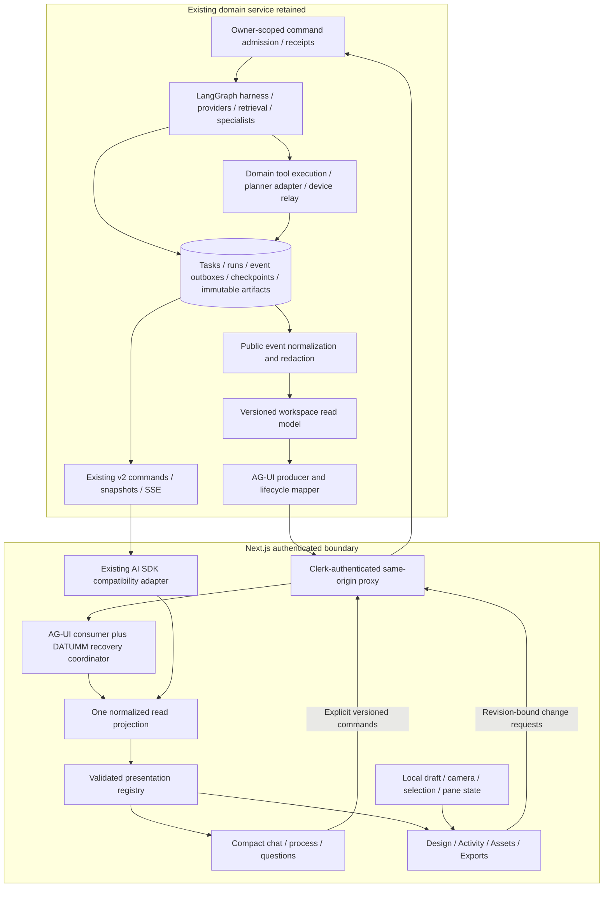

# DATUMM — proposed AG-UI target architecture

16 November 2026. **Approved for middle-chat implementation through the narrowed roadmap addendum.** Right work area/floor-plan state migration is deferred. This document describes a target, not a claim that all interfaces ship. Based on [current source audit](AGUI_CURRENT_ARCHITECTURE_AUDIT.md), [verified research](AGUI_FEATURE_RESEARCH.md) and [prioritized gaps](AGUI_GAP_ANALYSIS.md).

## Recommendation: Option B, entered through Option A

Keep the hosted LangGraph/domain service, device relay, storage, AI SDK compatibility path, existing AffectUI shell and Streamdown. Add a thin AG-UI projection at the domain boundary. Then introduce a small typed React presentation registry. Evaluate CopilotKit only if a measured capability gap justifies its additional runtime/state ownership; do not make it the default migration dependency.

| Criterion | A — minimal event adapter | B — adapter + typed registry | C — adapter + selected CopilotKit |
| --- | --- | --- | --- |
| Complexity | Medium: lifecycle/replay mapping is substantive | Medium–high incrementally; reuses domain UI | High in this app: adapter still needed plus ownership integration |
| Compatibility | Highest with current v2 paths | High; opt-in renderer over same projection | Plausible React support; AI SDK6/7 and AG-UI1.0.2/1.0.4 dependency differences need proof |
| Migration risk | Lowest if shadow/read-only first | Bounded per component with text fallback | More risk of dual stores, duplicate execution, changed approval behavior |
| Performance / latency | Event normalization adds work; no measured gain | Selective rendering can help; measurement required | Additional runtime/renderer work; actual cost unknown |
| Bundle | Protocol packages if client-side; no measured size | Above A plus lazy domain renderers | Wider dependency graph; tree-shaken shipped size unknown |
| Tokens | Mapping domain events need not call model | Compact discriminated specs may cost tokens; deterministic mapping first | Tool/schema/context exposure can increase tokens; no promised saving |
| Maintenance | Own domain mapping, conformance and replay | Own small registry contracts; reuse existing UI | Upstream hook/runtime churn plus domain adapter |
| Developer experience | Explicit, testable, familiar components | Consistent output authoring, typed fallbacks | Rich hooks and helpers, but more concepts/dependencies |
| User experience | Better observability only if producer emits data | Best fit: concise chat with useful actionable artifacts | Can match, but prebuilt chat adds little to current shell |
| Scalability | Durable event projection can fan out | Registry expands without changing transport | Framework services may add capabilities, with separate deployment/cost decisions |

These are engineering estimates, not benchmark results. A is Phase1, not an alternative rewrite; B is the selected recommendation for the complete roadmap. Existing tests and controls are an asset.

## Feasibility answers

1. **Can the backend emit AG-UI?** Yes, by mapping durable public records and adding missing producer instrumentation; current SSE is not already conformant.
2. **Official harness adapter?** LangGraph integrations exist, but the custom DATUMM v2 controller is not covered by a turnkey official adapter found in this audit.
3. **Custom adapter?** Required for task authority, questions, native approval, immutable artifacts and replay.
4. **Reuse endpoints?** Reuse v2 admission/snapshot/event mechanisms internally; expose a separate AG-UI route rather than changing existing response grammar in place.
5. **AI SDK coexistence?** Yes, through parallel compatibility adapters over one domain projection and one execution owner. Do not mount two execution-producing clients on the same task.
6. **Keep AffectUI?** Yes; the protocol imposes no replacement visual system.
7. **CopilotKit value?** Useful optional hooks/controlled UI; insufficient demonstrated incremental value to justify replacing this app's current state/chat layer now.
8. **MCP support?** Agent-side MCP/relay workflows continue; publish their safe operational evidence. AG-UI is not a tool executor or MCP substitute.
9. **Subagents?** Map actual persisted specialist invocation IDs and parent relationships; instrument missing lifecycle events first.
10. **Persistence/reconnect?** Keep durable task state and explicit DATUMM replay/observation extension; standard AG-UI HTTP does not solve reconnect.
11. **Synchronization changes?** Normalize read state, correlate events, preserve cursor/version guards, separate authoritative facts from local view state and submitted commands.
12. **Performance impact?** Added decoding/state and package costs are real possibilities; token/latency savings are unproven. Phase0/6 benchmarks decide.

## Component architecture



Only one execution-producing transport owns a task at a time. Shadow comparison observes recorded events; it must not submit a second model request. Existing read model is authoritative for domain values; neither useChat nor an AG-UI client becomes a second database. UI selects legacy or AG-UI adapter per feature flag and task generation, while both feed the same domain projection contract.

## Lifecycle and identity model

| Entity | Proposed identity / lifecycle | Durable owner |
| --- | --- | --- |
| Conversation | Opaque server-derived mapping from existing taskId to threadId, scoped to authenticated owner/project | Current task store; authorization from session, never trusted client account field |
| Domain execution | Existing executionId/turnId across checkpoint resume | Existing workflow/checkpoint records |
| Protocol run | Unique runId for each admitted protocol invocation/continuation | Adapter mapping record; resume creates a new protocol run even if domain checkpoint execution continues |
| Tool attempt | Stable toolCallId plus separate attempt/parent step identity | Execution instrumentation before dispatch; retry gets distinct attempt |
| Specialist invocation | job ID mapped to subagentRunId; parent child/tool relationships | Actual specialist job store, not role-name inference |
| Checklist | taskPlanId/version, stable step IDs; pending/running/blocked/succeeded/failed/skipped/cancelled | Harness task-plan evidence; UI counts only explicit verified completions |
| Artifact | artifactId, kind, immutable source revision/hash and status | Owner-scoped artifact/report store |
| Design | planId/version/fingerprint, parent version, engine/schema metadata | Existing immutable plan versions and validation |
| Question/approval | interruptId mapping to existing question/proposal IDs, version/hash, expiry and receipt | Server checkpoint and approval records; display state separate |

Terminal task, terminal model call, paused protocol run, accepted web concept and successfully applied Revit draft are different states. Label them separately. No generic completed flag can grant downstream authority.

## Event mapping and missing producer evidence

Use the selected AG-UI1.0 release schemas and validate producer output. Declare protocolVersion. Preserve safe domain correlation in `metadata.datumm` (custom extension), including source event ID, task sequence, domain execution/turn, projection schema and adapter version. Keep a deterministic mapping `(sourceEventId, outputIndex, adapterVersion)` for one-to-many transformations. Domain sequence is not a claim that AG-UI itself supplies replay IDs.

Research candidate pins are protocol1.0, TypeScript core/client/encoder1.0.4 and Python protocol1.0.0. Phase0 must freeze the exact schema/package digests and prove cross-language fixtures before installation/adoption; do not silently mix live-main documentation with a different installed schema. Auth/validation refusal before opening a stream stays an HTTP error. Failure after opening uses RUN_ERROR. Validate required message/tool/step closure and terminal ordering for success/cancelled streams; a truncated connection must never manufacture a terminal event. Unsupported terminal outcomes must fail safe in the DATUMM projection, not disappear into an older client's default-success interpretation.

| Domain observation | Proposed protocol representation | Guard |
| --- | --- | --- |
| Admitted execution | RUN_STARTED | Only after auth/admission; transport failure may emit permitted initial RUN_ERROR |
| Public operational update | ACTIVITY_SNAPSHOT/DELTA or STEP_* where real boundaries exist | No REASONING_* or private prompt/rawEvent payloads |
| Tool invocation | TOOL_CALL_START + redacted complete argument content + TOOL_CALL_END | Current action string alone is insufficient to reconstruct real arguments |
| Tool execution state | Versioned tool record in state/activity; actual TOOL_CALL_RESULT | END means arguments complete, not tool success |
| Current checklist | State/activity snapshot then bounded deltas | No checklist → say none recorded; no guessed counts or dependencies |
| Specialist start/end/error | SUBAGENT_* when instrumented with real job ID | Historical completion-only records remain completion evidence, not invented starts/durations |
| Answer | TEXT_MESSAGE sequence from admitted full saved answer | Initially emit completed text honestly; provider token streaming is a later producer change |
| Question / native approval | RUN_FINISHED interrupt outcome with QuestionSet/proposal schema | Persist boundary state/messages; bind existing receipts and native checks |
| Terminal outcome | RUN_FINISHED success/cancelled or RUN_ERROR per selected schema | Waiting is interrupt; unknown native outcome stays reconciliation-required in domain state |
| Usage | Verified per-run/provider usage on terminal event plus coverage-aware domain state | Shared execution totals must not be relabelled per-run totals |
| Artifact/revision availability | Allowlisted CUSTOM event or typed state reference | Fetch immutable payload through authenticated endpoint; never execute emitted code |

Suggested custom names: `datumm.artifact.available.v1`, `datumm.reconciliation.required.v1`, `datumm.presentation.v1`. These are proposed extensions, not AG-UI standard types. Keep unknown extensions safely ignorable with a generic artifact/status fallback. Never expose RAW wholesale.

## Command, interrupt and recovery flow

```mermaid
sequenceDiagram
 participant User
 participant UI as AffectUI workspace
 participant Adapter as Authenticated AG-UI adapter
 participant Domain as Existing task controller
 participant Store as Durable records
 User->>UI: Describe concept
 UI->>Adapter: Input plus idempotency and expected version
 Adapter->>Domain: Existing v2 command
 Domain->>Store: Admit command and execute once
 Store-->>Adapter: Durable events / projection
 Adapter-->>UI: Run started + actual process and state
 Domain->>Store: Versioned clarification checkpoint
 Adapter-->>UI: Snapshot + interrupt outcome
 User->>UI: Answer grouped question
 UI->>Adapter: Resume with interrupt mapping and receipt identity
 Adapter->>Domain: Existing versioned answer command
 Domain->>Store: Validate then continue checkpoint
 Adapter-->>UI: New protocol run and saved design reference
 Note over UI,Store: On disconnection recover authoritative task; never rerun a native write
 User->>UI: Review / request revision
 UI->>Domain: Revision-bound command via authenticated proxy
 Domain->>Store: Save immutable new version
 Store-->>UI: New version and short result
```

**Recovery is a DATUMM extension, not standard AG-UI HTTP resumption.** Retain existing `after` cursor/task snapshot endpoints. On a truncated stream, mark connection lost without declaring job failure; fetch authoritative task and pending question/approval state. A read-only observer reattaches through a custom connection adapter/replay channel, or falls back to existing polling. It must never issue another submit just to observe. `HttpAgent.abortRun()` only detaches/aborts HTTP; a user Stop must call the existing cancel command and await settlement. See [standard transport constraint](https://docs.ag-ui.com/spec/1.0/basic/transports/http-sse).

Before implementing the custom observer, specify its binding and conformance separately from standard POST runs: send a consistent snapshot at cursor N, then events greater than N; replayed protocol segments retain their identity and valid boundaries. Persist consumed source IDs, reject stale epoch/task/account data, and deduplicate before applying UI effects. If history is pruned, provide a full snapshot/reset instead of pretending there is a contiguous replay. Map simultaneous listeners to read-only subscribers, not extra workers. Bounded retry/backoff and heartbeat indicate liveness; they do not imply work progress.

Bind each resume entry to the latest interrupted protocol run and its domain task/execution/question-or-proposal/version/receipt. Resolve or explicitly abandon every interrupt; reject stale/expired resolutions server-side as well as client-side. A single grouped QuestionSet may carry all answers in one interrupt. Later only hides the form. Protocol abandonment does not implicitly revoke a native grant or cancel a domain task; an explicit domain command determines that effect.

Persist the command-idempotency-to-protocol-run mapping with taskVersion, eventCursor, turn/execution and stream-attachment generation. A crash after admission but before mapping publication must recover the already admitted command, not create another. Test a shared idempotency key through legacy and new routes, concurrent tabs and partly published one-to-many events. Account/project changes advance the local generation and invalidate old subscriptions.

Event ordering is per task projection sequence; timestamp is display data, not causal authority. Use idempotent publication/outbox mapping and unique adapter event keys. Maintain authoritative snapshots with cursor/version atomically or with a tested reconciliation algorithm. State deltas require matching base version; otherwise drop the patch and fetch snapshot. Slow consumers may coalesce replaceable progress/usage values but may not drop tool outcomes, approvals, revisions or terminal states.

## Shared state ownership

Proposed read model (conceptual, not executable implementation):

```text
WorkspaceProjection v1
  task {id, version, cursor, status, currentTurnId}
  executionsById / toolsById / specialistsById / checklist
  pendingInputs [{id, kind, version, expiresAt, sourceRef}]
  usage {scope, coverage, measuredCounts, contextEstimate}
  designRef {planId, version, fingerprint, schemaVersion}
  artifactRefs [{id, kind, sourceRevision, status}]
  presentationRefs [{id, kind, schemaVersion, sourceRef}]
```

Server owns these facts. The browser owns camera, pane width, opened details, unsent draft and temporary selection. User room/property changes are validated **commands** with expected design revision, never arbitrary STATE_DELTA writes. A small allowlist of nonauthoritative UI context (selected room IDs/current view) can travel to the agent after validation. Do not round-trip whole geometry, full diagnostics or every event into the model context. Project Brief remains explicit and source-labelled.

## Typed presentation registry

Latest clarification requires compositional UI, beyond a fixed choice of domain cards. Add a bounded layout tree whose agent-chosen primitives support stacks/grids, text, typed tables/charts, node/edge diagrams, forms and domain previews. The registry is a safe rendering vocabulary, not a mandatory visual template. Chart/diagram structure can vary by response; use strict data/schema limits and accessible alternatives. The agent needs an explicit presentation tool plus a compact frontend capability/context envelope; until those are integrated with the harness, a local renderer alone is not generative agent behavior. See the approved roadmap addendum for frontend awareness and scoped reversible actions.

Start with a bounded discriminated union, validated at producer and consumer boundaries. Example descriptor:

```json
{
  "schemaVersion": 1,
  "presentationId": "stable-presentation-id",
  "kind": "roomSchedule",
  "title": "Proposed room areas",
  "source": {"artifactId": "owned-artifact-id", "revision": 2},
  "placement": "assets",
  "actions": ["preview", "download"]
}
```

This illustrative schema does not authorize an action. Server resolves artifact ownership and source fingerprint; renderer maps enum actions to existing handlers. No emitted URL, component import, CSS, JavaScript, HTML or arbitrary function path is executable. Cap payload bytes, nesting, item counts and text lengths; version schemas; parse safely; reject prototype-polluting paths. Unknown/invalid component falls back to safe text plus an authenticated same-origin, owner-authorized artifact route constructed by the app, with telemetry, not a blank chat. Hash/revision metadata never substitutes for access checks. No model-directed network or local-file access is permitted. Expanded diagnostics show authorized redacted evidence, not a bypass around publication limits.

| Registry kind | Source / renderer reuse | Placement |
| --- | --- | --- |
| conciseAnswer | Saved answer → Streamdown | Chat |
| executionSummary | Actual run/tool/checklist records → TurnProcess + AffectUI ToolCallCard | Chat; details Activity |
| questionSet | Existing versioned QuestionSet → AgentQuestions | Above composer |
| webReviewNotice | Exact saved design → compact web acceptance | Chat; details Design |
| nativeApproval | Server proposal/grant → existing ProposalApproval | Prominent checkpoint; never generic UI-generated approval |
| roomSchedule / comparison | Immutable report data → existing table/report preview | Assets with compact chat link |
| floorPlan | Exact graph reference → existing PlanCanvas | Design |
| artifact | Owned file record → current Assets/Exports preview | Assets / Exports |
| chart / explanation / flow / mindMap | Validated bounded dataset or node spec; lazy approved renderer | Optional preview; text/table fallback |
| agentGraph | Actual dependency/parent records; optional React Flow | Activity, with equivalent accessible list |

Use deterministic tool-to-presentation mapping where output kind is known. Let a model choose only among a few appropriate kinds when choice adds value; validate referenced evidence. Avoid sending the entire component catalog on every run or adding a dedicated formatting model call. Chart/diagram nodes cannot assert quantities or dependencies absent from evidence.

## Floor-plan engine independence and Revit safety

Retain current PlanGraph as initial canonical model, with explicit schema/capability negotiation. Proposed `FloorPlanEngineAdapter` operations: describeCapabilities, generate, revise, validate, normalizeOutput. Each returns engine/version, stable units/origin/axes, levels, rooms/boundaries, walls, openings, dimensions, assumptions, validation findings and provenance. The domain layer computes/validates fingerprint and immutable revision; engine-supplied hashes are not trusted blindly. Unsupported curves/levels/elements must be rejected or clearly rendered as unsupported, not silently flattened.

Current engine remains the first adapter. Engine selection is independent from AG-UI; transport only carries progress and exact saved-design references. DXF is a future import/export adapter requiring unit/layer/entity validation and source lineage; it is not automatically equivalent to editable PlanGraph or a semantic Revit model. RVT requires a separately selected conversion/inspection workflow and cannot be rendered merely by adding AG-UI.

The current engine-tagged PlanGraph is a starting contract, not proof of engine independence. Before adding another engine, version canonical units/axes/geometry semantics, stable element IDs and deterministic fingerprint rules; retain original engine artifact and version with reversible lineage. Demonstrate lossless round-trip or explicit rejection for unsupported curves/levels/geometry. Old saved fingerprints are immutable: any canonical-schema conversion creates a linked new revision rather than rewriting historical hashes. Unsupported features must not produce fabricated Revit mappings.

First migration retains select/pan/zoom/measure/annotate, 2D/3D synchronization and agent-mediated revisions. Editable room properties, dimension input and wall/door dragging require a later approved command schema, geometry constraints, undo and conflict policy. Each edit creates/revalidates a proposal; it cannot mutate an already approved native plan. Preserve browser annotation validation in `use-workspace-state.ts:780–785` and selection guards at `:901–915`.

Native drafting remains: approve exact geometry/proposal → validate device/document/grant/expiry → translate geometry to existing supported Revit operations → execute through current bridge → collect independent read-back/evidence. Journal each supported step and actual Revit identifiers. If a connection drops after dispatch, show “Outcome not verified”; do not automatically replay a write. Reconcile with the same device/document, identify completed/failed/unknown operations, and require fresh approval for a changed proposal. Generic rollback/compensation is not promised; available Revit transaction semantics must be verified per tool.

## Visual, accessibility and security contracts

Keep AffectUI tokens/Inter, current licensed controls, dark/light/system, reduced motion and 224px navigation. One compact process block updates in place. Closed completed rows retain evidence counts; failed/waiting rows remain discoverable. Do not auto-expand every tool or auto-scroll away from a user inspecting history. Placeholder-only suggestions remain. Right Design stays drawing-only; Activity owns details and graph; Assets/Exports own preview/downloads.

Every dynamic surface needs keyboard access, stable focus, text status independent of color, labelled controls and restrained polite announcements. Announce phase/decision changes, not every token. Mobile uses ordered process lists instead of a mandatory graph; large tables scroll internally with readable headers; open previews return focus to their trigger. Existing pan/resize gestures cannot be the only control.

Clerk session authorization remains at the proxy and domain; recheck on reconnect. Enforce ownership per artifact and command; never accept model-provided account IDs. No secrets/private reasoning in events, metadata, snapshots or URLs. Redact tool arguments/results before publication. Treat retrieved text, Markdown and presentation specs as untrusted. Validate JSON Patch paths and quotas; never patch approval, grants or authoritative geometry from client state. Frontend tools initially allow only reversible display operations (open owned preview, focus validated room); no native writes or broad network/file access. CSP and URL allowlists must remain compatible with safe diagrams/downloads.

## Performance design, pending measurement

Index projections by entity/turn; subscribe narrowly; memoize renderers. Batch replaceable updates per frame or bounded interval while flushing checkpoints/errors immediately. Bound replay buffers, paginate historical events/artifacts and lazy-load graphs/charts/3D. Window long chat only after focus, selection, copy/search and screen-reader behavior tests. Keep large geometry/tool payloads behind immutable references; summarize model context separately from UI evidence. Use protocol JSON/SSE first; binary is not assumed faster and has feature/serialization caveats. All budgets and comparison experiments are in the roadmap; no current performance gain is claimed.

## Approval decisions

1. Approve B through A, retaining the harness and existing design system; no CopilotKit by default.
2. Approve a small registry first, with optional graph/chart renderers only when evidence warrants; A2UI remains evaluated future portability work.
3. Keep first floor-plan release review/annotation and agent-mediated edits, or explicitly expand scope to direct editing.
4. Approve Phase0 benchmark workload, privacy/retention limits and measurable acceptance targets before implementation.
5. Decide when to resume the separately paused count repair and its deployment gate. This architecture approval must not silently release it.
