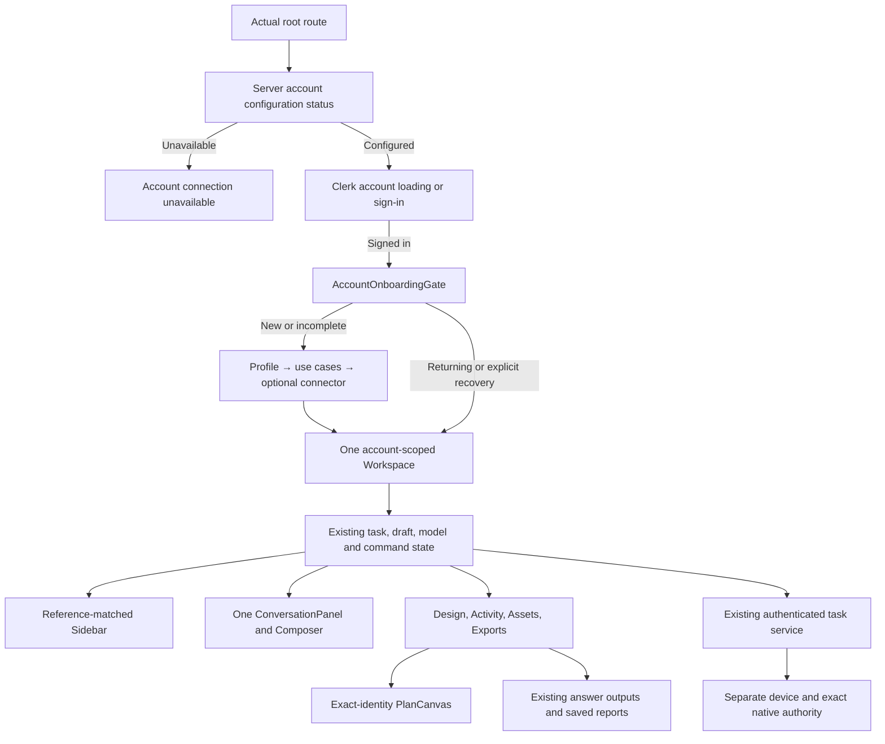

# DATUMM — complete affectUI migration

Author: RAJ-IITROORKEE  
Status: Full Option A baseline approved; selected M0–M8 source packages present; product workflow parity incomplete and under renewed audit; isolated AWS container qualification passed; native qualification and backend deployment remain open  
Date: started 12 November 2026; completed 13 November 2026  
Branch: `codex/ui-ux-foundation-2026-11-12`  
Predecessor: [accepted context](discussion_summary.md), [existing approved plan](PLAN.md).

## Product-audit addendum — 13 November 2026

Subsequent navigation answer confirms D21: compact project-centered structure, Running / Needs your input filters in the task/chat overview, Brief & decisions under Project context, and the same four right-side sections. Do not add separate top-level Tasks/Memory screens. Proposed package execution still awaits review.

The author requested findings and planning before further development. Read [the consolidated product audit](docs/ux/product-audit-2026-11-13.md) and PLAN.md's updated Component reference map. A real concept journey repeated known questions and ended without a plan despite lifecycle Completed; process/question/context/viewer gaps remain. Earlier successful technical tests and selected-control checks are not full product-parity acceptance. The baseline below is preserved; its completion shorthand must be read with this addendum and the current gap register.

Confirmed new directions: dark2D/3D drafting with separate white Sheet/Print; generate → review → revise as the primary web journey; project Brief & decisions first, personal memory later. Proposed chat/question, project-context, drafting, artifact and journey-qualification packages are **not yet approved for execution**. Backend changes, runtime MCP/skills, RVT upload/conversion, rule/memory persistence, deployment and native qualification remain separate. The source/research subagents in this audit were not a fresh formal Goldfish convergence loop.

13 November implementation ruling: the author's latest [exact Assistant Home reference](https://www.affectui.com/screens/assistant-home/full) refines M4/M6 without adding features. Use the measured 272px sidebar, three primary rows, workspace/account menus and two-layer 672×143px composer. Keep explicit Ask/Plan/Build in one current-mode menu, with Add left and model/voice/Send right; move real context actions into the footer tray. The web frame uses the full viewport; native window controls stay inside Desktop only. Web Share appears only in its current task workspace. Preserve drafts, guards and truthful unavailable states. [Current checkpoints](docs/ux/implementation-checkpoints.md) supersede future-tense package descriptions below.

## Current author refinements and reference authority

13 November: [PLAN.md Component reference map](PLAN.md#component-reference-map) is the canonical component-by-component design reference. Use its exact URLs and the measured [reference contract](docs/ux/affectui-reference-contract.md), then record actual interactions and validation in checkpoints. This EGM architecture and its M0–M9 packages continue; later author instructions refine those packages.

- M3/M4: the latest clarification replaces the earlier double-sidebar direction with Agent Chat's single248px navigation,52px collapsed icon column and shared narrow drawer. Real destinations, account isolation, draft and drawing retention stay required.
- Latest browser comments: recognizable panel buttons close/open the project list and work area; the later clarification supersedes the temporary header drag grips. Fix idle chat titles reserving unnecessary action padding.
- M6: thinking-state/tool-call/progress-tracker references and the author's simple checklist image guide a minimal per-answer process/todo display. Use real records and exact turn provenance; unknown ownership is labelled, never inferred as current progress. The latest [minimal Revit chat refinement](docs/ux/minimal-revit-chat.md) uses Agent / Thread's compact prose, folded tools and docked questions. The user authorized M6 with the announced defaults: concise completion, right-area full results, grouped questions and next-prompt drafts. Frontend and bounded backend source are implemented; deployment stays separate. Mermaid is optional for explicit requests. Preserve Streamdown full content, copy, security and exact approval contracts.
- Completed cleanup remains: simplified web header, Share in saved-chat menus, readable names with technical IDs collapsed. Preserve acceptance/native approval/read-back boundaries and defer deployment/merge decisions.

## Overview

Complete the migration in the real DATUMM application. The new-task screen and sidebar follow affectUI Assistant Home; the right inspector follows Agent Chat and exposes Design, Activity, Assets and Exports. Match the selected theme and visual hierarchy using measured reference evidence. Use licensed free source directly, and independently implement Pro patterns from public previews.

DATUMM remains an individual architect/BIM workspace: sign in, describe the user's work, optionally connect Revit, ask or plan, inspect drawings and structured results, then approve exact native changes when needed. Its real data, capabilities, account boundaries and model authority determine what a control can do.

## The Problem

Several application components are implemented and tested, but the root start screen is still split beside an empty drawing placeholder instead of matching the selected centered home. The sidebar, typography, density and surfaces also differ. Earlier component/browser checks proved selected behavior, not full visual parity. There is no complete direct-free-source/provenance ledger or agreed comparison pass for every shipping surface.

The real local onboarding cannot currently run because web account/service configuration is absent. Unconfigured auth silently opens the workspace and bypasses the onboarding gate. Showing a fixture does not resolve this product/configuration gap.

The current inspector contains Design/Activity/Exports-related functionality in older navigation; it does not yet provide the requested reference-matched four-section information architecture. Assets require a truthful source and empty/unavailable states. BOQ revision history and paid subscriptions still depend on service contracts and must not be inferred from existing presentation.

## Goals

1. **Ship on the real routes.** Update `/`, configured sign-in/onboarding, actual settings/account, `/connect`, `/pricing`, admin and saved work surfaces. `/dev/ux` remains a development-only test aid. Keep all work on the UI/UX branch; merge, push and deployment remain separate decisions.
2. **Match the selected home and sidebar.** Center the new-task greeting and shared composer; reproduce the reference's spacing, type, surfaces, menu/disclosure lifecycle, project/chat hierarchy and footer placement using real DATUMM actions and records. Existing saved tasks must remain accessible.
3. **Preserve the working workspace.** Once a task/drawing is present, keep the approved stable chat and larger work area, resize/focus behavior, camera, draft, selected plan and outputs. Home-to-task transitions must not discard context.
4. **Provide the requested inspector.** Design, Activity, Assets and Exports have consistent tabs, task/source identity, keyboard navigation and scroll ownership. Reuse existing real panels/data. Missing assets or exports explain availability rather than fabricating content.
5. **Complete the genuine account journey.** Google-first sign-in leads to name/domain, multiple use cases, optional Revit setup with Skip, and workspace. Resume incomplete setup; existing completed accounts keep their normal return journey. Missing auth configuration is visible and cannot masquerade as completed onboarding.
6. **Use affectUI source appropriately.** Every adopted free component has a verified public source, license and hash. Pro components have an observation/state ledger, independent DATUMM code and a recorded visual/behavior comparison. No gated source is required.
7. **Cover normal and recovery states.** Each migrated control is checked for empty/loading/ready/pending/error/disconnected/stale/unavailable states as applicable. Preserve drafts, feedback and exact identities through retries, navigation and task switches. Keep accessible focus, readable wrapping, reduced motion, dark/light themes and narrow layouts.
8. **Preserve authority.** Read-only navigation, plan acceptance, computer authorization, exact native approval, execution and measured verification remain distinct. Rich Markdown, a preview selection or a finished tool call cannot approve or verify Revit changes.
9. **Validate from beginning to end.** Record tests against the real local app and configured account/backend when available. Unit tests, synthetic fixtures, real browser behavior, reference parity and connected/native qualification have separate pass/fail entries. A release cannot be called fully verified while its required connected journey is blocked.
10. **Leave a usable handoff.** Maintain one ordered implementation ledger with exact reference links, production owners/files, required contracts, acceptance checks and remaining blockers so Sol 6.1 High workers can execute without the chat transcript.
11. **Replace the complete visual system.** The user's latest instruction applies affectUI colors and typography throughout the application, including existing screens. Legacy DATUMM palettes and hard-coded styles cannot silently override the new identity. Retain accessibility preferences and recoverable copies of replaced appearance settings.

## Non-Goals

- No unrelated backend rewrite, model/provider upgrade or native grant expansion to imitate a UI preview.
- No direct geometry dragging/resizing or spreadsheet formulas in this release; drawings are reviewed/annotated and schedules updated by the agent.
- No fictional agents, usage quotas, measured quantities, app connections, paid entitlements, confidence scores or Undo actions.
- No teams/invitations, collaboration, smartphone synchronization or full desktop feature parity in the initial individual-account web release.
- No Node/runtime upgrade or new REA MCP registration as incidental setup. Tool prerequisites are tracked separately.
- No merging, pushing or deploying as part of planning.

## Scope and constraints already decided

PLAN.md D1–D12 remain approved. The user explicitly selected [Assistant Home](https://www.affectui.com/screens/assistant-home) for the sidebar/start screen and [Agent Chat](https://www.affectui.com/screens/agent-chat) for the right inspector, adding the DATUMM Exports section. “Exact” applies to theme/layout/interaction fidelity; DATUMM names, its BIM content, working routes, permission boundaries and accessibility behavior remain authoritative.

See [the gap register](docs/ux/full-migration-gap-register.md) for the source-backed differences, pre-EGM fixes and acceptance blockers. The captured 272px sidebar and 368px reference inspector are measurements of one desktop view; responsive behavior must be specified and compared before those become defaults.

## Open Questions and dependencies

- Where are the existing development Clerk credentials and the correct account-compatible HTTPS service origin? The nominated software `.env` and linked Vercel Development environment do not supply them. Origin permission must be verified without weakening auth.
- The Technical Plan maps existing records into Assets. There is no general hosted upload/artifact-store contract; richer uploads and attachment metadata need a separately verified interface.
- The approved automatic-current BOQ revision/history workflow still lacks the required immutable service contract. Identify its backend owner and interface before a working-history claim.
- Paid activation, quotas and metering need the authoritative provider/entitlement contract. Free is current; $20 Pro and $99 Max are planned monthly individual tiers.
- The user's Revit screenshot is still needed for any more specific viewer reconstruction. Existing review controls can be refined independently.
- REA CLI cannot start on the current Node version. Continue evidence collection in the built-in browser; a supported REA runtime is a separately tracked prerequisite for tool-specific analyses.

## Technical Plan (Architecture)

This section is a design proposal for the real application. It contains no production implementation. Read-only Sol 6.1 High source analysis informed the mappings below; those workers were not formal Goldfish reviewers. Existing uncommitted audit fixes remain preserved.

### Complete affectUI visual system

The user's latest instruction replaces the entire visual system. The reference is the application inside the selected full-screen previews, rather than the affectUI marketing/catalog page surrounding them.

| Area | Technical treatment |
| --- | --- |
| Colors | Use the frozen dark/light roles in [the reference contract](docs/ux/affectui-reference-contract.md), including the observed `#141416` work surface. Collect only the remaining properties and states listed for M0; record new observations separately from the frozen baseline. Apply one token map through the root and all component surfaces. |
| Typography | Use the already installed, self-hosted Inter Variable face for the Inter reference family. Measure body, labels, headings, buttons, tables and secondary text separately; replace conflicting legacy sizes, weights, line heights and tracking. The observed home heading is 28px, weight 500, line height 34px at the captured desktop view. |
| Shapes and spacing | Record control height, corner radius, row density, icon size, gaps, padding, hairlines and hover/focus states. Use component-level layout rules, not a fixed screenshot scaled to every viewport. |
| Components and overlays | Apply the same system to buttons, inputs, menus, dialogs, tabs, tooltips, account screens, report tables, pricing and admin. Inspect vendor-inserted styles so an upstream component cannot introduce a second visual system. |
| Drawing and outputs | Match toolbar, canvas chrome, properties, selection/annotation controls, report/Markdown tables and diagram controls. Keep actual drawing geometry, semantic measurement colors, source provenance and printable/exported content readable. |
| Appearance persistence | Introduce a one-time appearance revision migration. Replace legacy built-in/custom color overrides as the active identity, retain one recoverable copy of the prior preference, and retain Light/Dark/System, contrast and motion preferences. The Appearance screen exposes the new reference variants; legacy palette/import controls cannot silently restore the discarded identity. |
| First paint | Update the CSS defaults and existing early appearance bootstrap together. A stored old palette must not flash before the new theme applies. Invalid storage and unavailable storage fall back to the same new baseline without blocking the app. |
| Accessibility | Keep necessary focus/contrast adaptations explicit in the parity ledger. Decorative separators and control boundaries use separate roles; do not strengthen every hairline just because a control outline needs stronger contrast. Light and dark variants require their own measured comparison. |

Production owners include `src/lib/themes/affectui.json`, `src/lib/appearance.ts`, `src/app/foundation.css`, `src/app/globals.css`, `src/app/layout.tsx`, `src/components/studio-workspace.css`, `theme-settings.tsx`/CSS and the affected component modules. DESIGN.md and its sidecar must describe the implemented new system after validation; their current palette description is historical until that change lands. The Detailed Implementation Plan enumerates the affected consumers.

### Production route and state ownership



The existing `useWorkspaceState` remains the owner of task selection, prompt, mode, model/effort, selected device, task commands and projection. Presentation changes consume that owner. There is no second agent client, independent event subscription, replacement task store or new generic artifact service.

`WorkspaceEntry` remains the account boundary; `Workspace` stays keyed by Clerk subject. `OutputWorkspaceProvider` retains selected-task isolation, but its current keyed state wrapper must change: today a new task key remounts the entire child shell. Keep the provider and shell mounted and invalidate only output state when authoritative task scope changes. Drawing state is keyed only by exact `planId:version:fingerprint`, rather than by shell mode, panel width or inspector visibility.

### Account configuration and onboarding

Separate account configuration from service configuration and runtime availability:

- **Account configuration:** the server checks the required Clerk configuration and passes only a safe readiness reason to the entry UI. The readiness payload contains no configuration values. Secret keys remain server-only and are excluded from logs and planning artifacts; Clerk's normal public publishable configuration remains available to its configured client. Missing configuration renders a real unavailable sign-in/setup screen; it does not mount an anonymous workspace as though onboarding finished.
- **Service configuration:** validate the configured HTTPS origin with the existing root-origin constraints. A signed-in account can still reach profile/setup/settings if the task service is unavailable; task admission remains disabled with an actionable connection state. Do not equate a syntactically configured origin with a healthy service.
- **Clerk loading and signed-out:** retain the configured Clerk loading/sign-in path and Google-first presentation. Actual sign-in uses the designated account environment; do not create a mock account or bypass origin checks.
- **Profile loading and incomplete setup:** retain `GET/PUT /api/account/profile`, Clerk private metadata ownership, checkpointed steps and existing field validation. Continue saves the next step before advancing. Back changes the current step locally. Failed saves retain the exact text/selections and focus the relevant error.
- **Completion:** both Skip for now and Open workspace persist the complete step. Downloading a plugin or checking devices does not complete setup, authorize a computer or select a model.
- **Authenticated compatibility:** the current gate admits completed profiles, and also accounts with existing run history when the stored profile is absent/unrecognized. Preserve this return journey and mark setup as unconfirmed rather than fabricating completion. Offer a gate-owned way to finish/retry setup using the same real profile component.
- **Authenticated profile recovery:** retain deliberate Continue to workspace when profile loading fails, without marking setup complete. Keep a visible setup-recovery action and the failure explanation. This authenticated recovery is distinct from the missing-account-configuration bypass being removed.
- **Unsupported stored profile:** the current API normalizes malformed/unsupported profile data to null. The UI cannot truthfully distinguish it from an absent profile without a server contract addition. Use an unconfirmed/needs-setup state; do not claim a precise invalid-profile diagnosis or silently destroy stored metadata.

The server profile API remains the profile authority. No new writable user ID, role, permission, completion bypass or client-held credential is introduced. Public pricing and intended public-share behavior remain available independently; admin routes keep their existing entry and backend gates. `/connect` retains request validation and its own explicit account/computer authorization flow.

Likely files: `src/app/page.tsx`, `src/app/layout.tsx`, `src/proxy.ts`, `src/components/workspace-entry.tsx`, `src/lib/auth-gate.mjs`, the existing onboarding component and styles, and a small server-only configuration helper if needed to share safe readiness derivation. Existing backend/profile guards remain authoritative. Exact file edits and tests belong in the detailed implementation list.

### Selected composition: Option A

The author selected Option A on 12 November 2026 and instructed completion of the full EGM plan and Sol 6.1 High reviews. Use three working columns: navigation, stable chat and the larger right work area. That right work area adopts the Agent Chat header and **Design / Activity / Assets / Exports** tabs. There is no additional permanent inspector column. Contextual properties open inside Design and close without hiding the right work area.

```text
navigation | stable chat | larger right work area
                          Design · Activity · Assets · Exports
                          drawing / selected output / saved report
```

Design identifies its current content type and source explicitly: Drawing, Answer output or Saved report. Switching sections hides the drawing without destroying its instance. Returning to Design restores the selected preview if its identity is still valid. Option B is retained only as a rejected alternative below, not an implementation branch.

### Home, admission and working-shell transitions

Keep one mounted ConversationPanel and one mounted Composer in their current ownership chain. Center and size that existing component through the shell's visual state; do not render a second home composer or move it between React parents.

The output provider receives `scopeKey` without using it as a React key. Its state record contains scope, an incrementing scope epoch, registered sources and selected output. On a scope mismatch, reset that record in the provider's own render before rendering descendants, rather than in a passive effect; React retries that component with the empty new-scope record. Every registration/open/close callback captures the epoch and applies only while it still matches the current record. This also rejects late cleanup from an earlier visit to the same task. Pending copy feedback and scheduled focus restoration carry the same epoch guard. Output-only presentation may reset with the epoch; the shell/composer and exact drawing identity boundary do not. The Clerk-subject key still resets the entire account-owned workspace on account change.

| Shell state | Source and visible behavior |
| --- | --- |
| New task | No selected/admitted task. Center the reference greeting/composer and useful supported suggestions. Hide the empty drawing placeholder and working-pane switch. Keep project context, draft, mode and model controls usable according to real capability/readiness. |
| Admission pending | The first request is pending, but no authoritative task identity is available. Keep the centered layout and show submitting feedback without inventing execution. Keep the submitted draft revision separate from newer edits. |
| Task identity received | The existing `data-run`/selection path establishes task identity. Transition to the working shell even if the full snapshot/drawing is still loading; show task loading rather than falsely returning to New chat. |
| Task loaded | Show stable conversation and the selected work-area content. Drawing focus is available only when geometry/SVG is renderable, independently of whether the task has been admitted. |
| Admission rejected | Preserve/restore the captured draft through the existing recovery handler, keep newer edits and attachments owned by their current source, remove the rejected optimistic message and explain retry. |
| New chat / saved task selection | New chat restores its account/project draft and retains the existing mode/model/effort semantics. Selecting a saved task restores that task's source/model context. Do not transfer a late response, output or pending feedback into the newly selected task. |

Current `hasContent` includes optimistic messages, so it cannot alone decide authoritative admission. Derive the shell scene from existing task/admission state and an explicit pending-admission marker exposed by the hook; leave task command admission, idempotency and draft confirmation logic unchanged.

Focus drawing changes layout/visibility around the existing viewer. Opening outputs or reports hides the same drawing container; returning restores camera, selection and local comments for that exact identity. Actual drawing identity replacement intentionally resets incompatible view/selection state. Neither home layout transitions nor tab changes may add a new drawing key.

### Sidebar, search and suggestions

Match the reference's brand/project header, search affordance, main actions, pinned group, project disclosure, recent chats and account footer. Populate all records from existing project/task state and keep unknown-project tasks reachable.

- Keep the existing capability-guarded project/chat actions and their expected revision/task-version bindings: create/select, pin, rename, move, archive/restore and confirmed deletion. Pinned chats appear once. Search must reveal matching chats inside collapsed projects.
- A reference-style search dialog wraps real loaded task/project title search and supported navigation actions. Search is explicitly scoped to loaded records unless the backend provides a wider query. Enter activates the selected result; Escape closes and returns focus to the original opener. The shortcut must not hijack editing fields or a higher-priority dialog.
- Connections uses the existing device/setup destination. Projects uses real supported project navigation. The account footer uses the signed-in account and existing actions. Do not reproduce fictitious Acme accounts, integrations, changelog items or completion percentages.
- Home suggestions fill the shared composer or navigate to an existing supported flow. They do not auto-submit an agent task, switch approval policy or imply that Revit is connected. Ask/Plan/Build remain explicit; Build mode itself grants no native authority.
- Attachments and dictation preserve the actual Desktop capability boundary. If a web action is unavailable, its explanation remains discoverable by keyboard; matching a reference icon does not enable an absent upload or microphone service.

The reference's bare Request approval and Auto controls do not replace DATUMM's mode, model catalog or exact approval panels. Record this deliberate functional adaptation in the comparison ledger while matching the visual control vocabulary.

### Design, Activity, Assets and Exports contracts

Replace the current inspector tab union with one typed four-section model. Map every existing opener/reset: `preview` becomes Design, `activity` becomes Activity, `exports` becomes Exports; the obsolete assistant entry targets the stable chat. Move tools/catalog diagnostics to Activity's diagnostic disclosure or existing Settings → Capabilities. Retire the old overlay's `right` visibility meaning; opening/closing properties affects an inner Design disclosure, not visibility of the whole right work area. Do not merely rename labels while old state setters select unreachable tabs.

| Section | Source of truth | Content and actions |
| --- | --- | --- |
| Design | Exact selected drawing, current plan reference, selected element, source context and existing design/native records | Keep 2D/3D review, properties, brief/assumptions, versions/comparison and exact-review navigation. Preserve the distinction between a saved design and a later native proposal. Also host the existing large-output/report preview with an explicit content-type title and Return to drawing. |
| Activity | Existing latest-task/turn projection, lifecycle, supplied tool evidence, manifest and public updates | Reuse the real compact summary and ActivityPanel. Keep failed/stopped/unconfirmed records, search scope and task identity. Runtime/memory/desktop traces remain deliberate lazy disclosures. Planned checklist rows are not executed workers. |
| Assets | Projection of the existing selected task's inputs and saved results | Show typed groups described below. Selecting an available item opens its existing preview. Missing metadata, unavailable preview and unsupported upload have explicit states. An empty Assets tab never triggers an agent run or native operation. |
| Exports | Existing supported export list, exact selected plan/version/style, completed answer outputs and validated saved reports | Show actual authorized downloads with type/source/scope. Group plan drawings, saved task reports and local retained-row exports clearly. Keep incomplete/unsupported/permission/error states and explicit retry. |

Maintain a single preview authority: existing active answer output and saved-report selection are mutually exclusive; drawing remains mounted beneath them. Opening a large answer/report selects Design's preview content and gives it an explicit content-type/source title plus Return to drawing. This does not change the prompt, current plan, native approval or report's source identity.

PlanDetails currently combines version review and download controls. Presentation may expose review controls in Design and download controls in Exports, but both consume the same selected plan identity and preserve every existing action. Capability checks must agree: an explicit `supportedExports` exclusion disables that format everywhere; legacy missing capability metadata remains distinguishable from an explicit exclusion and service failure.

### Assets and export data boundaries

| Asset kind | Existing identity/owner | Allowed web presentation |
| --- | --- | --- |
| Draft attachments | Account/source-scoped `sourceDrafts` and `ComposerSource` IDs | Keep separate from saved task inputs; show only metadata already supplied. Current web upload is unavailable. Do not describe attachments as reload-persisted text drafts. |
| Saved attachment references | `run.conversation[].attachmentIds`, saved source selection and existing Desktop preview bridge | Preserve IDs. Names, thumbnails or download controls require actual authorized metadata/capability. In web-only records, an ID-only row and unavailable preview explanation are valid. |
| Saved drawings | `Run.currentPlanRef`, retained candidates and loaded DrawingVersion | Open the exact existing plan/version/fingerprint; distinguish current, retained and unavailable drawing. |
| Answer reports/tables/diagrams | Saved/streaming answer text projected through `answerOutputs` and OutputWorkspaceProvider | Read-only previews. Their UI IDs are not service artifact IDs or immutable revision IDs. Partial/streaming state stays attached to actions. |
| Saved BOQ/element report | Authenticated `export/report-json`, parsed typed report | Load on demand. Retain source kind, execution/task binding, document/model revision, source plan version, coverage and limitations. Preserve the current bounded preview and full validated CSV dataset. |
| Specialist artifacts | Existing supplied task-bound artifact references and hash-addressed download path | Offer only known supported completed artifacts through the existing proxy. Never concatenate model-supplied arbitrary URLs into download actions. |

Assets is not a new artifact database. No generic list/upload/delete/revision endpoint is invented. Task/account changes invalidate asset selection, request completion, copy/download feedback and metadata cache before another task's first render. Same-task background updates retain the report snapshot being reviewed until deliberate refresh/reopen.

Source model revision is distinct from output revision. The approved D9 immutable sheet/BOQ workflow needs a separate authoritative contract for ownership, revision IDs, current-pointer commit, history, conflict/idempotency and revision-bound exports. Until that contract exists, the UI labels retained saved evidence accurately and cannot claim automatic authoritative history. Failed/stale work must not replace the last ready report.

Keep the existing service proxy's allowlist, task ownership, Clerk bearer token, no-store/nonredirect behavior and exact query identity. Plan exports retain task + plan + version + style. Local answer-table CSV and retained BOQ CSV remain distinct from service exports and do not acquire new measurement authority.

### Free-source adoption and Pro reconstruction

Create a component ledger that maps each real screen/control to a free import, a Pro reconstruction or a deliberate DATUMM-specific adaptation. A component is not complete until its real production caller is identified and tested.

| Source type | Acquisition and integration contract |
| --- | --- |
| Free | Use the public official registry/source, retain the applicable license and record retrieval date, canonical URL, source path and content hash. Keep upstream source under a dedicated `src/components/vendor/affectui/` boundary with a separate license/provenance record. Integrate through the existing production component; no competing UI framework or automatic dependency installer is needed for a self-contained component. |
| Pro | Use public full-screen previews, component previews and visible interaction evidence. Record state, viewport/theme, focus/keyboard, opening/closing, scrolling and reset behavior. Implement independent code and compare again. Do not request gated code or infer undocumented success behavior from autoplay. |
| DATUMM adaptation | Document exact-mode controls, approval authority, real capability limitations and accessible contrast/focus differences. These adaptations must preserve the selected visual system and be independently verifiable. |

The inspected free Tool Call Card registry is `https://www.affectui.com/r/tool-call-card-clean.json`; its upstream MIT license names Florian Höller (adfects). Registry SHA-256: `4ff47f4a18c1fe07fefdec08178a06cc188dd6a0d564d04475c4e811bfe5e7d0`. Extracted upstream source SHA-256: `cc8f4c7a581e0c7fd7d05faa63122d06d01542e71c4df75dd0a88f1365c839ff`. These identify the inspected artifact, not a deployed import or upstream release tag. Additional free components require the same acquisition record before use.

Its public status type supports running/success/error, while DATUMM also has stopped, stale, unknown and unconfirmed records. The adapter must not coerce those into success or active execution. Any narrow source adaptation needed to retain those states, suppress a fabricated mount-time runtime timer, or preserve missing output versus `0`/`false`/`null` must be documented and tested. Do not add retry buttons without an authorized service callback. Inspect source safety, styles and keyboard behavior before adoption; a license is not a compatibility test.

REA's evidence discipline remains applicable. Its current CLI runtime blocker does not authorize an incidental Node/MCP/engine upgrade. Use the requested built-in browser for reference and app comparisons, label unavailable REA tool analyses and retain bounded local evidence. Do not claim CLI analysis ran successfully.

### State, focus and responsive rules

| Surface | States and required recovery |
| --- | --- |
| Entry/account | Account configuration unavailable; Clerk loading; signed-out; profile loading; unconfirmed/absent profile; incomplete; complete; authenticated compatibility/recovery. Sign-in setup does not silently become a usable anonymous workspace. |
| Home/composer | Empty; valid draft; unsupported capability; admission pending; rejected admission; service unavailable; upload/media/action busy. Keyboard and button submission share the same gate, retain IME/shortcut handling and protect newer edits. |
| Sidebar | Loaded/empty/search/no-match; collapsed group; pending rename/move/archive; conflict/error/unsupported route. Keep the current record and focus on failure and make cancellation possible when safe. |
| Design | Drawing loading; no drawing; exact current; retained; stale; read-only/unavailable native action; failed export; selected/comment/measure state. Keep clear exact identity and a recovery destination. |
| Activity | Queued; running; waiting; paused/blocked; stopped/failed; complete; unconfirmed evidence; empty/unavailable diagnostics. Lifecycle authority wins stale transport flags. |
| Assets | Empty; ID-only metadata; ready preview; loading; unsupported; denied; unavailable/stale; no search match if filtering is provided. Retain task/source identity and never fetch another account's item. |
| Exports/reports | Supported ready; incomplete/streaming; empty saved report; unavailable format; unauthenticated/denied; malformed/oversized data; network error; stale source; pending download feedback. Export the explicit dataset and version. |
| Settings/admin/billing | Loading; unchanged/dirty; valid/invalid; saving; saved; failed/conflict; denied/unconfigured; Free/current and paid/upcoming. Retain inputs and server authorization, and distinguish runtime configuration storage from active tool capability. |

Keyboard rules: one active layer owns Escape; menus/dialogs return focus to their real opener; tabbed panels use labelled tablist/tab/tabpanel semantics and keyboard selection. Switching a narrow pane must not leave focus inside a hidden subtree. Do not auto-focus or announce the entire growing event log on every streamed update. Give a concise contextual status instead. Keep user-expanded disclosures stable until their task/turn scope changes.

Preserve the existing same-mounted Focus drawing and restore contract. Persist navigation/chat dimensions under unambiguous semantic names; the selected right work area takes the remaining width. Legacy `datumm-panel-widths.right` is chat width and must never be silently reinterpreted as a separate inspector width. The detailed implementation section specifies the versioned write format and clamped legacy migration. Resizing keeps pointer cancellation, keyboard Arrow/Home/End and reset behavior.

Use 1440/1280/1024/768/390/320 CSS-pixel checkpoints for the implementation comparison matrix. Existing 1180/850/500 behavior is a baseline to verify rather than proof that the new content fits. At narrow widths expose one primary Chat / Work area destination, keep navigation as an accessible drawer and keep the chosen inspector composition contained. Home needs no useless Chat/Drawing switch before a task. Test long project names, real multiline answers, tool payloads and 200% text zoom; narrow text inputs use at least 16px and no page-wide horizontal overflow.

### Critical user journeys and acceptance

| Journey | Given / When | Required result |
| --- | --- | --- |
| CUJ-1 Real first visit | Valid account configuration; signed-out visitor signs in and has no confirmed profile/history. | Actual Google-first sign-in leads through required name/domain and multiple use cases, optional connector with Skip, persisted completion and the real centered home. No fixture or synthetic account. |
| CUJ-2 Setup recovery | Incomplete setup, failed save, reload, or signed-in profile service failure. | Resume the last successful step; retain current failed entries. Deliberate authenticated recovery never invents completion and offers a route to retry/finish setup. |
| CUJ-3 Missing environment | Required account configuration is absent or task service configuration/reachability fails. | Render the appropriate unavailable account or workspace-service state with a truthful recovery action; no automatic task or auth bypass. Public pricing/share behavior remains intentional. |
| CUJ-4 First Ask/Plan | Valid draft at Home; submit is admitted or rejected. | Exactly one real composer/request path. Pending admission is clear; authoritative task identity opens the working shell. A rejection preserves the right draft revision, mode, context and newer edits. |
| CUJ-5 Return to work | Open, search, pin, rename or move a saved task/project. | Correct account/task records and existing server version checks; no hidden unknown-project task; failed updates retain usable state and focus. |
| CUJ-6 Design review | A current plan is available; select, pan/zoom/orbit, measure, annotate and enter/exit Focus drawing. | Same plan identity and mounted viewer; preserved camera/draft on return; exact local annotation/context chips; no native edit from review navigation. |
| CUJ-7 Large outputs | Open a saved/streaming table, diagram or report from chat/Assets, then return to drawing. | Preserve chat and drawing. Correct content type/source title and completion gates; late copy/export feedback cannot attach to another output. Typed full-data exports remain distinct from bounded preview rows. |
| CUJ-8 Four-section navigation | Task has partial/ready/no assets or exports; use mouse and keyboard across the four sections. | Correct selected-task data, tab/focus/scroll behavior, useful empty/unavailable states and no extra agent run or model authorization. |
| CUJ-9 Revit computer setup | Optional onboarding download/check or a valid `/connect` request. | Download/check/review do not authorize. The existing explicit Allow this computer action remains account/request-bound and distinct from active-model selection. |
| CUJ-10 Native proposal | A designated connected environment supplies an exact proposal; inspect, refresh or deliberately approve it. | Exact task/document/revision/hash/expiry bindings survive styling. Expired/stale proposals fail closed. Commit and independently measured verification remain separate; unknown outcomes reconcile the original operation. |
| CUJ-11 Settings/usage/pricing | Navigate from real account/footer; change a supported preference or inspect usage/billing. | Initial/section focus, persistent validated appearance/preferences, actual task usage provenance and current Free/planned individual Pro $20/Max $99 monthly tiers. No unsupported paid action. |
| CUJ-12 Administration | Authorized or denied administrator opens current admin routes. | Existing entry/backend gates, configuration revisions, validation, error/conflict recovery and truthful stored-only MCP state; same new visual system. |
| CUJ-13 Scope switch | Change task/account while assets, reports, diagnostics or clipboard feedback are pending. | No prior scope's content, success/error feedback or selection appears under the next identity. Obsolete work is aborted/discarded; drafts remain correctly scoped. |
| CUJ-14 Narrow/reduced-motion | Repeat the representative journeys at the narrow/text-zoom checkpoints and with reduced motion. | Readable controls, contained scrolling, accessible drawers/tabs/focus return, no hidden focused field or animation-dependent information. |

CUJ-1/2/4/9/10 need the real configured environment and, for native work, a designated test document/device and deliberate approval. Unit/synthetic checks support these journeys but cannot mark the connected journey passed.

### Component ownership and interface map

| Ownership boundary | Current production seam | Planned responsibility |
| --- | --- | --- |
| Entry/account | `page.tsx`, `layout.tsx`, `proxy.ts`, `workspace-entry.tsx`, auth/profile gate | Safe configuration derivation, real sign-in/setup/recovery, account remount and public route behavior. |
| Shell integrator | `workspace.tsx`, `use-workspace-state.ts`, `studio-workspace.css`, `desktop-titlebar.tsx`, layout helper | Single state owner; Home/admission/task scenes; unified Option A work area; semantic width migration; focus and output/drawing continuity. |
| Sidebar | `workspace/sidebar.tsx`, `chat-row.tsx`, project-create and history helper | Reference presentation, real hierarchy/search/actions/footer; preserve revision/ownership and unsupported-capability guards. |
| Composer/answer | `workspace/conversation.tsx`, `workspace/composer.tsx`, `model-picker.tsx`, message/output renderer | One composer, modes/context/model support, exact approval cards and structured answer behavior in the new theme. |
| Right work area/inspector | `workspace/inspector.tsx`, ActivityPanel, PlanDetails and existing properties | Typed four-section navigation in the larger right work area. No permanent overlay inspector, duplicate primary viewer or independent task subscription. |
| Assets/exports | Existing source/drawing/answer/report/specialist owners plus a small presentation projection if needed | Typed task-scoped rows and real preview/download destinations, with explicit provenance/capability/failure handling. |
| Global visual system/vendor | Appearance/theme/foundation, affected modules and dedicated affectUI vendor directory | New system across all routes; versioned legacy appearance retirement; free license/hash/adaptations and Pro parity ledger. |
| Settings/admin/commercial | Current production settings, account editor, connector, pricing and admin components | Apply the new system without changing actual permissions, metering, billing or runtime authority. |

One integrator owns edits to shared shell/hook/conversation and global token files; parallel workers receive non-overlapping files and stable props. The Detailed Implementation Plan below lists created/modified test, document and production files in execution order. No production module is changed during this EGM drafting phase.

### Validation and contract limits

For each migrated surface record separate results for source/component tests, real local browser behavior, reference visual/interaction parity, connected service behavior and native qualification. Compare the same reference variant/state/viewport, retain captures and fix visible differences before another capture. Log deliberate content/capability/accessibility adaptations explicitly. No numerical similarity or accessibility score is claimed without a measured method and supporting evidence.

The current 168-test result belongs to the preserved pre-EGM audit fixes. Their final production build is still pending. New implementation requires proportionate regressions, sequential final type checking/build, runtime route/auth/origin checks and representative actual browser journeys; reference-only or development fixture screenshots cannot close root-route acceptance.

Environment configuration, authoritative BOQ revisions, paid entitlements/metering and real Revit verification remain owned dependencies. The visual migration can be reviewed in source and on available real routes while those are unresolved, but the complete release journey remains blocked until each required contract is qualified.

## Alternatives Considered

| Alternative | Benefit | Rejection and retained limits |
| --- | --- | --- |
| Separate drawing work area plus overlay/docked inspector (Option B) | Preserves the existing inspector opener and most current placement. | Rejected by the author through the explicit selection of Option A. A separate overlay can obscure the drawing; a permanent dock consumes a fourth column. Option A consolidates navigation into the larger right work area. |
| Deliver only `/dev/ux` fixtures | Fast deterministic checks without configured services. | Rejected by the author: the actual root application, real account journey and saved work must receive the migration. Fixtures remain development-only test support. |
| Preserve the old theme with new-looking panels | Smaller CSS change and no appearance preference migration. | Rejected by the author's explicit whole-application color/typography replacement. Recover one prior preference for safety, but do not keep it as the active visual system. |
| Import gated Pro source | Could reproduce the implementation directly. | Outside the selected approach. The author requested direct free source and independent Pro reconstruction from public previews; source acquisition must respect that boundary. |
| Build a generic artifact/revision service as part of the layout | Could unify inputs, generated assets and historical schedules behind new APIs. | Outside this frontend migration's verified contracts. Use the existing task-scoped projections; authoritative D9 revision history remains a separately specified backend dependency. |
| Restart native task/approval transport to fit the reference | Could simplify superficial component props. | Rejected by the existing authority requirements: exact task/proposal/document/revision bindings and unknown-operation reconciliation are working boundaries that presentation must preserve. |

These alternatives come from the predecessor context, the existing system and the author's explicit Option A/theme/source instructions. They are not attributed to an upstream maintainer.

## Risks and mitigations

| Risk | Mitigation and stop condition |
| --- | --- |
| Visual similarity is mistaken for measured parity | Freeze the selected reference state and compare actual routes at matching viewports/fonts. Unmeasured or visibly different roles stay open; a passing build is not parity. |
| A free component changes keyboard, value or permission semantics | Preserve the existing production caller contract, inspect the pinned source and add focused adapter tests. Unsupported statuses/actions remain explicitly unavailable; never coerce them into success. |
| Home/task or tab transitions remount working content | Keep one ConversationPanel/Composer and one normal primary drawing instance. Derive shell scenes from authoritative admission; hide the Design subtree instead of reparenting it. Test camera/draft/focus continuity. |
| Global theme replacement damages saved preferences or accessibility | One bounded backup precedes preference migration. Storage failure applies the new baseline in memory without overwriting the legacy record. Contrast, motion and theme mode remain explicit; necessary parity exceptions require recorded approval. |
| Assets leaks another scope or invents a file store | Project only supplied task/account-bound records; abort/discard late loads; preserve authorized proxy routes. ID-only and unavailable states are acceptable. |
| Missing auth is hidden by a demonstration path | The real root shows configuration unavailable. Synthetic fixtures remain production-404 and cannot close configured-account acceptance. |
| Service/native/billing dependencies are confused with frontend completion | Track those journeys independently and leave them blocked until the real contract/environment is qualified. No new native grant or paid checkout is part of a visual migration. |
| Large responses and hidden diagnostics consume unnecessary work | Retain the bounded report parser/preview and lazy diagnostics, avoid per-row network fetches and keep actual loaded-record scope visible. Do not build new caches, workers or schedulers. |

## Detailed Implementation Plan

### Execution contract and fixed interfaces

The author selected Option A and requested the complete plan and Sol 6.1 High EGM reviews. Drafting/review is consolidated; implementation has not started under this revised specification. Keep all production audit fixes already present in the working tree. Do not reset or replace that work to obtain a clean baseline.

The following are the implementation contracts; an implementer does not choose a new storage model, route, backend or pane composition:

- **Scene:** `home`, `submitting`, `task-loading`, `task`. New/first-prompt pending state stays centered until an authoritative task identity exists. A selected/restoring task ID uses task-loading until its snapshot settles. Existing optimistic `messages` alone are not admission. Failure returns the captured draft through the existing revision-aware handler.
- **Right work area:** `design`, `activity`, `assets`, `exports`, default Design per newly selected task. Its Design subtree remains mounted through section/focus/output changes. `propertiesOpen` controls only an inner Design disclosure/drawer. No outer right-area close button, overlay backdrop or permanent fourth column remains.
- **Design preview:** `drawing`, `answer-output`, `saved-report`, using the existing output/report ownership. Explicitly opening an answer/report selects Design and the narrow Work area pane. Closing returns to the same drawing, with focus to the original opener if still connected, otherwise the labelled Drawing control.
- **Review navigation:** approval/review links select the stable chat pane and focus the existing exact card; close properties without hiding/resetting the right work area. No review-navigation action sends an approval or grants device/task access.
- **Layout persistence:** write `datumm-workspace-layout-v2` with version 2 and numeric `navigationWidth`/`chatWidth`. Read it first; otherwise migrate `datumm-panel-widths.left` to navigation and `.right` to chat using the existing legacy special conversions and bounds. Default navigation is the measured 272px; chat keeps the current 380px default. Navigation clamps 180–440px, chat 320–620px. Right work area fills the remainder; there is no separately persisted inspector width.
- **Effective desktop widths:** at ≥1180px reserve two frame gaps from the frozen contract; cap effective chat width at half the remaining width after navigation/gaps so Design is at least as wide as chat. At a resize, normalize navigation first within its bounds, then chat within its bounds and available space. If both minimums cannot fit, use the existing one-primary-pane mode rather than negative dimensions. Temporary viewport clamping does not overwrite stored preferences; an explicit user resize/reset does. At ≤850px use the navigation drawer; ≤500px use the narrow header. Home uses its own centered content and has no empty Chat/Work area switch.
- **Appearance persistence:** write a version-2 affectUI preference under the existing `datumm-appearance` key. Preserve valid Light/Dark/System choice. Before replacing a legacy record, retain one bounded backup under `datumm-appearance:before-affectui-v2` (maximum 16 KiB, do not overwrite an existing backup). If the backup/new write fails, leave legacy storage untouched and apply the new baseline in memory. Do not reactivate a legacy palette/custom override after a refresh. Existing contrast/motion preference keys remain unchanged.
- **Theme values:** use [the frozen reference contract](docs/ux/affectui-reference-contract.md), then complete its explicitly listed M0 measurements. Values are appearance inputs, not permission for implementers to invent substitutes. Preserve RGBA/alpha layers and shadows through trusted baseline tokens; remove the old six-digit-hex assumption for those trusted tokens. Do not accept arbitrary CSS from imported user JSON. Body/control typography follows the measured 13px/20px Inter role; the home heading follows 28px/500/34px/−0.7px. Narrow text inputs retain the explicit 16px usability rule, recorded as an adaptation if the corresponding reference differs.
- **Free source:** pin public components to upstream commit `7d0f0984b856d56c362c7bc5ed67b023e776aa2f` and verify [the source inventory](docs/ux/affectui-source-inventory.md) before copying. Keep upstream source/license and a patch ledger. Reuse existing public wrapper imports to limit caller churn; adapter modifications preserve controlled values, ref/focus, disabled/pending and form semantics. No new runtime dependency is authorized: the inspected imports use already installed React/React DOM.
- **Assets rows:** a task-scoped presentation value with stable `taskId + kind + supplied identity`, kind, display title, provenance, preview availability and a destination descriptor. Allowed kinds are draft attachment, saved attachment reference, saved drawing, answer output, saved report and specialist artifact. These are frontend rows, not new service artifact IDs. Missing names use `Attachment · <supplied ID>`; no invented thumbnails or download URL. Draft attachments are visibly unsaved and remain in their existing source-scoped owner.
- **Exports:** explicit support exclusion wins everywhere. Missing capability metadata uses the current legacy guarded availability rather than pretending explicit support. Service rejects/denials remain visible with retry/recovery. Keep exact task/plan/version/style or report/source binding; local typed CSV is named separately from service exports. No arbitrary model-supplied URL or fabricated revision export route is added.
- **Account configuration:** server-derived account-ready status requires the existing Clerk configuration; client receives only a safe reason. Task-service origin validity/reachability is a separate state. Missing account configuration never mounts Workspace. Existing authenticated history/profile-recovery paths remain explicit and never mark onboarding complete. Keep profile ownership and all service/admin/native checks unchanged.

**Safe configuration interface (M2):** create the server helper `src/lib/web-configuration.ts`, exporting `getWebConfiguration(env: Record<string, string | undefined> = process.env)`. It returns `{account: {configured: boolean, reason: 'configured' | 'missing' | 'partial'}, service: {configured: boolean, reason: 'configured' | 'missing' | 'invalid'}}`, with no environment values. Account requires both non-whitespace Clerk keys; neither present is missing, exactly one present is partial. This is configuration presence, not credential health. Service requires an HTTPS root origin with no credentials/query/hash; missing and invalid are distinct, and configured does not mean reachable. This module is imported only by server files and test transpilation, never a client bundle.

Root Page, RootLayout, proxy, `/connect` Page, admin layout, backend and profile route consume that same account decision. Root/provider use `account.configured`; WorkspaceEntry may receive only the safe reason additionally. `/connect` retains `DeviceAuthorization`'s existing `request: string | null` and `authConfigured: boolean` props, passing `account.configured`; invalid request recovery still runs before account-unavailable presentation. Only the configured branch mounts Clerk hooks. Proxy retains same-origin rejection first and public-share handling, then skips Clerk when configuration is unavailable. Admin retains 404 before account lookups when unavailable. Backend/profile return their existing 503 unavailable responses before calling Clerk when unavailable; all token, verified-email, role, ownership, profile metadata and fetch-origin logic remains unchanged. `authGateState(false, …)` becomes `unavailable`, included in its declaration; no anonymous Workspace fallback remains. Root unavailable markup has `data-account-configuration="unavailable"` and the heading `Account sign-in is unavailable`, both asserted by runtime smoke.

**Appearance record (M1):** `Appearance` is `{version: 2, palette: 'affectui', mode: 'system' | 'light' | 'dark'}`; the default mode stays dark. Stored legacy records contribute only a valid mode after the bounded backup. `parseAppearance` accepts the version-2 shape and rejects custom colors/other palettes; a separate migration path handles legacy storage, never arbitrary imported CSS. `appearanceTokens` returns the trusted frozen role map without the old hex-only/readability rewrites. High-contrast overrides remain explicit; normal alpha roles are not silently strengthened. The early bootstrap and hydrated reader use the same migration decisions and trusted map. Bootstrap also restores `data-motion=reduce` when the existing `datumm-motion` value equals `reduce`, otherwise full; do this before rendering on every route without rewriting that stored preference. OS reduction is independently respected by each adopted animation controller. Appearance offers Light/Dark/System, existing contrast/motion controls and download of the retained prior JSON when present; there is no legacy-palette Restore action.

**Shared appearance reader (M1):** export `readAppearance(storage?: Pick<Storage, 'getItem' | 'setItem'>): Appearance` from `src/lib/appearance.ts`. Resolve optional browser storage inside try/catch. It accepts a valid v2 record, otherwise recognizes a legacy plain object with no version and a valid mode; ignore all legacy color fields. Malformed/unsupported input or denied reads returns default Dark. For a readable legacy record, derive the new mode first, then attempt the existing bounded backup/new-record writes; UTF-8 raw bytes determine the 16 KiB bound. Failed/oversized backup or failed new write leaves legacy storage untouched but **returns the derived v2 preference**, never throws into a default-Dark fallback. No module cache or new store is added. Bootstrap mirrors this same policy. ThemeSettings stored hydration/cancel/cleanup reads and the workspace hook's initial/system-change reader all call `readAppearance`; only UI/save validation calls strict `parseAppearance`. `saveAppearance` uses the same backup-before-replacement guard and throws on write failure without overwriting legacy storage; existing preview/error handling retains the unsaved choice. Test bootstrap, actual hook hydration and a system-change callback with readable legacy Light/System and independently failing backup/new writes.

**Normative work-area interfaces:** [M3/M5 contracts](docs/ux/work-area-contracts.md) fixes exact type exports, controlled Inspector slots/actions, selected-ID scope and epochs, report/output exclusivity, Assets inputs/destinations/deduplication and activation, Exports props and explicit alternative selection. Read it with this section before dispatch; it is part of the Detailed Implementation Plan. M3 creates the type seam and buildable slots; M5 consumes it and its integrator performs the final mounts. Ordinary Assets preview opens only the already loaded exact drawing. Unloaded candidates have unavailable preview and a separately labelled, revision-checked Review/select alternative action; navigation never invokes that mutation implicitly.

**Normative free-source interfaces:** [Adapter contracts](docs/ux/affectui-adapter-contracts.md) fixes the per-role upstream exports, native/Radix/Slot boundaries, exact props/variants/sizes/ref/events, visual-only source patches, actual production callers, truthful tool timing/status/payload and clipboard behavior. It is part of this Detailed Implementation Plan. Adopt 22 of the 24 inspected sources: omit NumberInput and ProgressTracker because existing native numeric drafts and recorded checklist owners retain their semantics. M1 creates the patched visual foundation; each subsequent package mounts its listed role through the existing production owner. No role is complete until that real caller is qualified.

### Ordered work packages

Every package below leaves a buildable, testable intermediate commit. Paths labelled new/Create are created; other listed production and test paths are modified. There are no deletions. Create `docs/ux/implementation-checkpoints.md` in M0; the other named tracking documents already exist and are modified. Package completion requires its own focused checks, relevant browser evidence and a handoff entry. The manifest in each package is its write allowlist. No directory-wide production glob or unapproved adjacent refactor is allowed. If an additional source file becomes necessary, record the dependency and update this plan before editing it.

#### M0 — freeze references and preserve the working baseline

**Depends on:** author-selected Option A and the existing branch. **Owner:** parent/integrator.

Read the current dirty diff and retain the pre-EGM audit tests/fixes. Separate their results from new migration results. In the built-in browser complete the frozen contract's remaining Home widths, row/control/tab dimensions, focus/menu and narrow-state measurements, then inspect the listed account/settings/admin/output reference states. Use the existing public previews; acquire no gated source. Record source state/theme/viewport and exact measured properties. If a required state cannot be observed, mark that surface blocked and do not choose an alternate appearance silently.

**Write allowlist:** `docs/ux/affectui-reference-contract.md` (measurements, role mapping and exceptions), `docs/ux/affectui-source-inventory.md` (pinned public sources/hashes), `docs/ux/full-migration-gap-register.md` (measured differences/blockers), `docs/ux/implementation-checkpoints.md` (new per-package ledger), `PLAN.md`, `PROJECT.md`, `docs/ux/HANDOFF.md`, `design_draft.md`. Raw captures remain ignored under `artifacts/ux/`; no private credentials/model payload is committed.

**Exit:** actual root baseline and source revision recorded; required reference role table complete for the first implementation package; source hashes/license verified; missing configuration remains a named blocker. M1 cannot start from guessed tokens. Later surface-specific packages likewise cannot close before their M0 reference rows are complete.

#### M1 — direct free components and complete global theme foundation

**Depends on:** M0's measured core role contract. **Owner:** visual-system worker; integrator owns shared wrapper integration.

Copy only the pinned free files listed below; preserve names and MIT license. Add the adapter/patch ledger with each real caller. First verify shared Button/Input/Dialog/Menu behavior with one real caller per role; retain the existing wrapper APIs so migrated and not-yet-reworked pages still function. Inspect focus/portal behavior rather than assuming that a self-contained source file is a drop-in Radix replacement. Use the exact compositions and named visual-only exports in the adapter contract; there is one interactive controller per layer. Preserve native input/select events and Slot/Radix refs; record each selected source patch. Specialized caller mounts belong to M2/M4/M6/M7 as listed, while M1 verifies existing shared-wrapper callers and their API compatibility.

Replace the active visual system and early boot together. Expose explicit root roles for page/panel/tray/composer, ink/body/muted/faint, separators, focus, state, typography, radius, elevation and motion. Update consumers to use the correct role rather than a blanket opacity or border override. Preserve a recoverable legacy preference and modes/accessibility; remove active legacy palette/import choices from Appearance. Include actual Clerk appearance and all public/admin routes in the token application. Preserve DATUMM identity text/logo and actual BIM content.

**Exact new vendor files:** `src/components/vendor/affectui/button-clean.tsx`, `src/components/vendor/affectui/icon-button-clean.tsx`, `src/components/vendor/affectui/text-field-clean.tsx`, `src/components/vendor/affectui/text-area-clean.tsx`, `src/components/vendor/affectui/checkbox-clean.tsx`, `src/components/vendor/affectui/select-clean.tsx`, `src/components/vendor/affectui/switch-clean.tsx`, `src/components/vendor/affectui/dialog-clean.tsx`, `src/components/vendor/affectui/dropdown-menu-clean.tsx`, `src/components/vendor/affectui/tooltip-clean.tsx`, `src/components/vendor/affectui/separator-clean.tsx`, `src/components/vendor/affectui/skeleton-clean.tsx`, `src/components/vendor/affectui/segmented-control-clean.tsx`, `src/components/vendor/affectui/badge-clean.tsx`, `src/components/vendor/affectui/empty-state-clean.tsx`, `src/components/vendor/affectui/message-actions-clean.tsx`, `src/components/vendor/affectui/tool-call-card-clean.tsx`, `src/components/vendor/affectui/change-summary-clean.tsx`, `src/components/vendor/affectui/profile-menu-clean.tsx`, `src/components/vendor/affectui/avatar-clean.tsx`, `src/components/vendor/affectui/popover-clean.tsx`, `src/components/vendor/affectui/card-clean.tsx`, plus `src/components/vendor/affectui/LICENSE.txt` and `src/components/vendor/affectui/PROVENANCE.md`. Each file is the pinned upstream source of that name; unused future catalog components are outside the allowlist.

**Modified production files and rationale:** `src/lib/themes/affectui.json` (trusted new color role data); `src/lib/appearance.ts` (new preference version, trusted alpha tokens, backup/fallback and boot); `src/app/globals.css`, `src/app/foundation.css` (default roles, type, interaction states and first paint); `src/app/layout.tsx` (font/Clerk appearance); `src/components/theme-settings.tsx`, `src/components/theme-settings.module.css` (new theme modes and removal of legacy active palette choices); `src/components/studio-workspace.css` (replace active shell literals). `src/components/onboarding/onboarding.module.css` (parent-owned surface-valued --muted compatibility aliases only; M0 ruling recorded). `src/components/workspace/use-workspace-state.ts` (only appearance import/initial/system-change reader and denied-storage accessibility-preference read guard, integrator serialized). Shared compatibility consumers: `src/components/ui/button.tsx`, `src/components/ui/input.tsx`, `src/components/ui/card.tsx`, `src/components/ui/badge.tsx`, `src/components/ui/dialog.tsx`, `src/components/ui/dropdown-menu.tsx`, `src/components/ui/tooltip.tsx`, `src/components/ui/separator.tsx`, `src/components/ui/switch.tsx`, `src/components/ui/sheet.tsx`, `src/components/ui/button-group.tsx` (all resolve under `src/components/ui/`; preserve their current caller contract while consuming the selected free roles). Add `tests/appearance-migration.test.mjs`, `tests/affectui-adapters.test.mjs`; update `DESIGN.md`, `.impeccable/design.json` and the two reference/source ledgers.

**Tests/exit:** legacy/new/invalid/storage-denied appearance; one-time backup not overwritten; first paint and refresh stay new-themed; mode/contrast/motion preserved; exact alpha/type/style measurements in both themes; controlled empty/false/zero values, ref focus, disabled/form submit, dialog Escape/return and portalled menu clipping. Document any required upstream patch before accepting its caller. No new manifest/lockfile dependency change.

#### M2 — actual sign-in/onboarding availability and account recovery

**Depends on:** M1. **Owner:** account worker.

Add the fixed safe configuration interface above, then update all seven existing account-configuration callers together, including the server `/connect` page. Missing account configuration shows a real account-connection-unavailable screen; valid account configuration uses actual Clerk loading/Google-first sign-in and the existing profile gate. Keep task service failures separate so an authenticated user can still inspect/edit their account and complete optional connector setup. Preserve existing authenticated-history compatibility and explicit profile-load recovery, with truthful setup-unconfirmed/retry UI. Reuse the real saved profile form; no development-preview bypass or invented profile storage.

**Write allowlist:** new `src/lib/web-configuration.ts`; modified `src/app/page.tsx`, `src/app/layout.tsx`, `src/proxy.ts`, `src/app/connect/page.tsx`, `src/app/admin/layout.tsx`, `src/lib/backend.ts`, `src/app/api/account/profile/route.ts` (the last three change only the configuration guard specified above); `src/components/workspace-entry.tsx`, `src/lib/auth-gate.mjs`, `src/lib/auth-gate.d.mts`, `src/components/onboarding/account-onboarding.tsx`, `src/components/onboarding/onboarding.module.css`, `src/components/account-admission.tsx`, `src/components/account-admission.module.css`, `src/components/connections/device-authorization.tsx`, `src/components/connections/device-authorization.module.css`; `tests/auth-gate.test.mjs`, `tests/onboarding-profile.test.mjs`, `tests/device-authorization.test.mjs`, `tests/runtime-smoke.mjs`, new `tests/web-configuration.test.mjs`, `README.md`, `.env.example` (names/instructions only; no real values).

**Tests/exit:** missing/both-present/each-partial/whitespace configuration, malformed/non-HTTPS/non-root origin, actual signed-out/loading/incomplete/completed and authenticated recovery; a syntactically valid 32-character `/connect` request under public-key-only configuration renders unavailable without mounting Clerk hooks or sending authorization requests; invalid-request recovery takes precedence in every configuration. Assert root/provider/proxy/connect/admin/backend/profile consume the shared decision. Account switch cancels obsolete profile results; Unicode/validation/save failure preserves fields; Back/resume and connector Skip; install/check never authorizes. Runtime smoke requires the unavailable marker/heading or the existing configured entry, without accepting arbitrary broken markup. Admin/auth/origin/share boundaries remain unchanged. Full real sign-in/profile persistence remains blocked until designated configuration is supplied; never weaken origin allowlists as a test shortcut.

#### M3 — one home/composer and the Option A unified right work area

**Depends on:** M1/M2. **Owner:** shell integrator; no parallel writes to shared files.

Implement the fixed scene/layout contract, retaining one ConversationPanel/Composer. Remove the output provider's scope-keyed child remount and implement the scope-record/epoch protocol above in this package, before moving shell content. Put four-section navigation in the actual `workspace-drawing` section. Repurpose the existing Inspector as the contained work-area section host with a stable Design-content slot; remove its old outer overlay/backdrop/close semantics. Keep the drawing container and exact identity key in that slot when sections/outputs/focus change. Replace old tab/right-open callers throughout the hook/conversation/workspace with explicit section/properties actions. The main Activity destination still reuses the real ActivityPanel; native-review navigation still targets chat.

Implement the version-2 navigation/chat widths and effective clamping described above; right area fills the remaining width. Resize reset is 272px navigation / 380px chat, with the existing pointer/keyboard behaviors. Properties is an inner Design disclosure/drawer. Capture layout/focus before Focus drawing; restore the previous valid preview, pane widths and opener on exit, or fall back to Drawing if its previous output no longer belongs to the current identity. Never restore an old task's artifact.

**Write allowlist:** `src/components/workspace.tsx`, `src/components/workspace/use-workspace-state.ts`, `src/components/workspace/conversation.tsx`, `src/components/workspace/inspector.tsx`, `src/components/workspace/output-workspace.tsx`, `src/components/workspace/plan-details.tsx` (callback wiring only), `src/components/desktop-titlebar.tsx`, `src/components/panel-resize.tsx`, `src/components/studio-workspace.css`, `src/lib/workspace-layout.mjs`; new `src/lib/work-area-contract.ts`, `src/components/workspace/work-area.module.css`; `tests/workspace-layout.test.mjs`, `tests/activity-integration.test.mjs`, new `tests/unified-work-area.test.mjs`, `tests/layout-preferences.test.mjs`, `tests/output-canvas-interactions.test.mjs`, `tests/plan-details.test.mjs`. Supporting development fixtures may update props only: `src/components/dev/ux-preview.tsx`, `src/components/dev/review-preview.tsx`, `src/components/dev/activity-preview.tsx`, `src/components/dev/admin-preview.tsx`. Their production-404 route stays unchanged.

**Tests/exit:** no duplicate composer; first admitted task preserves actual composer/shell DOM nodes; task ID before snapshot; pending/rejected first admission; selected task versus optimistic message; new-project drafts and saved task restoration; obsolete enum/openers removed; normal section switches retain canvas/camera; exact drawing replacement resets incompatible state; output/report/focus return; no stale output visible on a scope-changing render; late register/cleanup/copy/focus callbacks rejected across A→B→A task transitions; account change resets all account state; resize migration including legacy special values and viewport-only clamp; pointer cancel/keyboard reset; tab arrows/Home/End and Escape ownership; no focused node left hidden on narrow pane change. Real root captures show centered Home and working three-column Option A.

#### M4 — reference sidebar and real navigation/search

**Depends on:** M3 public state/actions and the fixed free-source adapter mappings. **Owner:** navigation worker.

Match header, search, navigation groups, row density/disclosure and account footer using real project/task records. Add a reference-style loaded-record search dialog. Use the current search/filter data: task/project title matching is case-insensitive, supported navigation actions are grouped separately, and empty/loading/no-match are explicit. Clear the temporary search filter on close so ordinary sidebar browsing does not silently retain a hidden result filter. Enter activates only a valid result; Escape returns the opener; Ctrl/Meta+K is the reserved command shortcut when no higher-priority dialog owns it. Preserve ordinary typing/IME behavior. Keep every current supported mutation/revision check and unknown-project task; do not invent demo changelog/team/upgrade actions.

**Write allowlist:** `src/components/workspace/sidebar.tsx`, `src/components/workspace/chat-row.tsx`, `src/components/workspace/project-create.tsx`, new `src/components/workspace/sidebar.module.css`, `src/components/workspace/search-dialog.tsx`, `src/components/workspace/search-dialog.module.css` (all resolve under `src/components/workspace/`); `src/lib/sidebar-history.mjs`; `tests/sidebar-history.test.mjs`, new `tests/sidebar-search.test.mjs`; existing shell integrator files only through the integrator if a new callback is required and this manifest is updated before that edit.

**Tests/exit:** pinned dedup, collapsed-project search, unknown/default project history, names with Unicode/long text, no-match/clear/keyboard result selection/focus return, unsupported project route, pending/conflict/error mutation, account footer, drawer close/restore and selected task scope. Profile/avatar source uses actual Clerk account data and actions. This package mounts the adapter-contract ProfileIdentity/Avatar and native IconButton, plus the Sidebar collapse Tooltip and account-footer Separator; no duplicate popup controller is introduced.

#### M5 — Assets, Design details and exact Exports

**Depends on:** M3 typed section/preview interface; M4 only for shared navigation links. **Owner:** outputs worker.

Implement the exact pure projection, bound inputs, discriminated destinations, metadata/deduplication and activation rules in the M3/M5 supplement. Ordering is saved drawings, answer outputs, saved report, saved attachment references, specialist artifacts, then clearly unsaved draft attachments; within a kind retain supplied order. Exclude foreign task/account bindings. Do not fetch every asset or add server listing/upload endpoints. Exact loaded drawings open without mutation; unloaded candidates remain preview-unavailable until the user deliberately chooses the separately labelled alternative-selection action. ID-only attachments have unavailable preview/download states. Unknown metadata is omitted, not replaced with fictional names/counts.

Split PlanDetails presentation so version/assumption/comparison actions are in Design and actual download links are in Exports, backed by the same selected plan. Normal Design uses the single primary canvas; a deliberate version-comparison mode may show its existing readonly comparison view, but opening a details/export tab must not create an accidental duplicate interactive canvas. Keep authorized service export routes/query parameters, supported-format rules and report parser bounds.

**Write allowlist:** new `src/lib/workspace-assets.mjs`, `src/lib/workspace-assets.d.mts`; new `src/components/workspace/assets-panel.tsx`, `src/components/workspace/assets-panel.module.css`, `src/components/workspace/exports-panel.tsx`, `src/components/workspace/exports-panel.module.css`; modified `src/components/workspace/plan-details.tsx`, `src/components/workspace/plan-details.module.css`, `src/components/workspace/output-workspace.tsx`, `src/components/workspace/output-workspace.module.css`, `src/components/workspace/review-report.tsx`, `src/components/workspace/review-report.module.css`, `src/components/agent-specialists.tsx`; `tests/plan-details.test.mjs`, `tests/answer-outputs.test.mjs`, `tests/review-report.test.mjs`, `tests/output-canvas-interactions.test.mjs`, new `tests/workspace-assets.test.mjs`, `tests/workspace-exports.test.mjs`. Additional M5 integration writes are explicitly authorized only to the integrator: modify `src/components/workspace/inspector.tsx` and `src/components/workspace.tsx` to replace M3 placeholders with the typed mounts/actions. The outputs worker does not edit those shared files or redesign M3 types. Props-only M5 compatibility writes: `src/components/dev/review-preview.tsx` and `src/components/dev/ux-preview.tsx`, serialized by the integrator with the exact synthetic scope/surface/report callbacks in the work-area supplement; retain synthetic fetchers and production-404 routes.

**Tests/exit:** each row kind and absent metadata, duplicate/foreign IDs, draft versus saved distinction, task/account switch while loading, preserved same-task report snapshot, missing/explicit capability support, exact plan/version/style links, partial/completed answer actions, empty/denied/unavailable/oversized report, bounded preview versus full CSV, zero/false/null/Unicode, formulas neutralized in textual CSV fields and no arbitrary download URL. D9 history remains unavailable until its real contract is supplied.

#### M6 — composer, answer, activity and exact-review component parity

**Depends on:** M1 free components, M3 shell and M5 preview interface, including both normative contract supplements. **Owner:** conversation worker; integrator serializes shared ConversationPanel edits.

Implement the exact M6 adapter contract, then apply the measured Pro composer/model/answer hierarchy while retaining actual Ask/Plan/Build, runtime model/effort, context chips, attachments capability and existing task/queue handlers. Consume direct free MessageActions/ToolCallCard/ChangeSummary at their actual production call sites. Tool status/time adapters must preserve unknown/stopped/unconfirmed states and must not invent a running duration from mount time. Expose only real copy/export/navigation actions; do not add feedback, retry or approval callbacks unsupported by the service.

Keep all current exact proposal, deletion-closure, plan acceptance, native result and measured comparison controls. Their status/identity/evidence remain visible in the new type/color system. Stop/resume/question/retry invokes only the current handlers; stream end still does not mean server/native completion.

**Write allowlist:** `src/components/vendor/affectui/tool-call-card-clean.tsx`, `src/components/vendor/affectui/message-actions-clean.tsx`, `src/components/vendor/affectui/PROVENANCE.md` (only the specified M6 semantic patches and patch hashes); `src/components/workspace/output-workspace.tsx`, `src/components/workspace/output-workspace.module.css` (serialized with M5, existing output/answer copy owner); `src/components/workspace/composer.tsx`, `src/components/workspace/conversation.tsx`, `src/components/workspace/turn-process.tsx`, `src/components/workspace/turn-process.module.css`, `src/components/workspace/activity-panel.tsx`, `src/components/workspace/activity-panel.module.css`, `src/components/workspace/activity-shell.module.css`; `src/components/model-picker.tsx`, `src/components/composer-controls.module.css`, `src/components/composer-media.tsx`, `src/components/ai-elements/message.tsx`, `src/components/ai-elements/reasoning.tsx`, `src/components/ai-elements/tool.tsx`, `src/components/ai-elements/conversation.tsx`; `src/components/agent-activity.tsx`, `src/components/agent-activity.module.css`, `src/components/agent-memory.tsx`, `src/components/agent-questions.tsx`, `src/components/opencode-questions.tsx`, `src/components/agent-scheduler.tsx`, `src/components/pipeline-trace.tsx`, `src/components/planning-goal.tsx`, `src/components/task-outcome.tsx`, `src/components/draft-assessment.tsx`, `src/components/evidence-results.tsx`, `src/components/saved-turn-result.tsx`; `src/components/review/proposal-approval.tsx`, `src/components/review/plan-review-card.tsx`, `src/components/review/change-summary.tsx`, `src/components/review/review-panels.module.css`; `src/components/design-review.tsx`, `src/components/design-review.module.css`, `src/components/native-build-review.tsx`, `src/components/native-build-progress.tsx`, `src/components/native-build-review.module.css`, `src/components/build-comparison.tsx`, `src/components/build-comparison.module.css`. Existing tests to extend: `tests/composer-interactions.test.mjs`, `tests/activity-integration.test.mjs`, `tests/activity-panel.test.mjs`, `tests/agent-activity.test.mjs`, `tests/turn-process.test.mjs`, `tests/review-approval.test.mjs`, `tests/design-review.test.mjs`, `tests/native-build-review.test.mjs`, `tests/build-comparison.test.mjs`.

**Tests/exit:** keyboard/pointer/form readiness parity, IME/slash menu/focus, draft revision recovery, actual model compatibility, terminal/paused lifecycle versus stale flags, finite recorded duration, hidden model-step text, duplicate task/turn actions, failure/retry inputs, expiry between render/click, exact identity unchanged, no optimistic approval/native verification, bounded revisions and unchanged native permission boundaries. Browser compare all selected visible pending/ready/failure states; unchanged transport helpers remain read-only.

#### M7 — complete account/settings/admin/pricing surface parity

**Depends on:** M1/M2 and the shared primitives. **Owner:** account/admin worker, serialized where source ownership overlaps M2.

Mount the adapter-contract onboarding Checkbox/loading and SettingsGroup Card through their real owners, then finish the new visual system on real onboarding, profile/account/preferences/appearance/models/connections/capabilities/usage/billing, public pricing and every existing admin page. Apply source-backed reference section hierarchy and control density. Retain actual account storage, task usage provenance, current Free and planned Pro $20/Max $99 monthly individual tiers, unavailable checkout, actual installer metadata, revision-aware admin forms and backend gates. Do not introduce team management, a new billing provider, fake quota or active MCP tooling.

**Write allowlist:** `src/components/desktop-settings.tsx`, `src/components/desktop-settings.module.css`, `src/components/onboarding/account-onboarding.tsx`, `src/components/onboarding/onboarding.module.css`, `src/components/connections/device-authorization.tsx`, `src/components/connections/device-authorization.module.css`, `src/components/plugin-setup-guide.tsx`, `src/components/project-context.tsx`, `src/components/workspace/brief-chips.tsx`, `src/components/workspace/share-dialog.tsx`; `src/components/billing/pricing-plans.tsx`, `src/components/billing/pricing-plans.module.css`, `src/app/pricing/page.tsx`; `src/app/admin/admin.css`, `src/app/admin/layout.tsx`, `src/app/admin/page.tsx`, `src/app/admin/agent/page.tsx`, `src/app/admin/skills/page.tsx`, `src/app/admin/mcp/page.tsx`, `src/app/admin/web-search/page.tsx`, `src/app/admin/knowledge/page.tsx`, `src/app/admin/plugin/page.tsx`, `src/app/admin/audit/page.tsx`; `src/components/admin/admin-shell.tsx`, `src/components/admin/config-sections.tsx`, `src/components/admin/data-sections.tsx`, `src/components/admin/form.tsx`, `src/components/admin/admin-form.module.css`, `src/components/admin/data-sections.module.css` (resolve admin component basenames under that directory); `src/app/share/[token]/page.tsx`, `src/app/share/[token]/not-found.tsx`. Extend `tests/settings-navigation.test.mjs`, `tests/onboarding-profile.test.mjs`, `tests/admin-config-editor.test.mjs`, `tests/admin-knowledge.test.mjs`, `tests/share.test.mjs`, `tests/device-authorization.test.mjs`, `tests/runtime-smoke.mjs` (all test basenames under `tests/`). Account API/admin client/proxy/authorization implementations remain unchanged unless a separately reviewed necessity is added to the manifest.

**Tests/exit:** opening/reopening/section focus and drawer return, pending/error/conflict values, empty/search/no-match states, theme changes on all real routes and overlays, actual tier text with disabled paid actions, anonymous/admin/backend gates, public share restrictions and source-bound images. Existing protected source/backend actions retain their checks. Capture each route/required reference state in the parity ledger.

#### M8 — drawing, annotation and output-control visual parity

**Depends on:** M3/M5/M6 and measured drawing/output chrome roles. **Owner:** drawing worker.

Apply new tokens/type to all browser drawing controls, properties, local exact-plan annotation surfaces, 2D/3D chrome and output toolbars. Preserve exact geometry, model/plan identities, units, measurement/selection semantics and readonly review boundaries. Reference-style comments adapt to local annotations; they do not claim project synchronization or multi-user discussion. Printed/exported technical drawings retain their explicit light technical-render contract and readable measurements; a global dark UI must not silently make a construction PDF dark or alter its geometry. Any further Revit-specific reconstruction waits for the user's reference screenshot.

**Write allowlist:** `src/components/plan-canvas.tsx`, `src/components/plan-canvas.module.css`, `src/components/plan-three.tsx`, `src/components/plan-three.module.css`, `src/components/plan-drawing.tsx`, `src/components/studio-properties.tsx`, `src/components/workspace/plan-dock.tsx`, `src/components/prompt-content.tsx`; `src/components/workspace/output-workspace.tsx`, `src/components/workspace/output-workspace.module.css`, `src/components/workspace/review-report.tsx`, `src/components/workspace/review-report.module.css` (serialize edits with M5); `tests/output-canvas-interactions.test.mjs`, `tests/plan-geometry.test.mjs`, `tests/plan-details.test.mjs`, `tests/plan-pdf.test.mjs`, new `tests/drawing-theme.test.mjs`. `src/lib/plan-geometry.mjs`, `src/lib/plan-pdf.ts` and native/model protocols are read-only for this visual package.

**Integrator-only M8 compatibility allowance (13 November implementation ruling):** `src/components/studio-workspace.css` receives only the existing `.plan-dock*`, `.studio-properties-panel`/`.studio-property-*` and `.viewport-reference-*` visual-role/type/control-density corrections. These selectors are already owned by the shared shell stylesheet; the drawing worker does not edit it. No geometry or new state owner is introduced.

**M7/M8 qualification correction allowance (13 November):** source review found stale same-task comparison/plan-binding and placement-context completions in `src/components/workspace/use-workspace-state.ts`. The integrator may serialize a worker's bounded exact-identity/scope/generation guards there, with actual-hook regressions in `tests/unified-work-area.test.mjs`. These changes prevent stale selection/grant requests and display updates; they introduce no new model action or approval authority. Account setup may treat failed/malformed history reads as unavailable rather than confirmed empty history, using its existing explicit recovery path. Admin local unsaved edits may receive a discard/leave guard within the existing shell/form owners; backend permissions and saves remain unchanged.

Admin correction also includes `src/components/admin/use-admin.tsx` and the already-listed server admin layout: key the shared in-memory config draft by the authenticated subject, and reject old load/save completions after that owner unmounts. Pass only the existing authorized user's subject to the client provider; retain all current verified-email/admin gates. Do not persist admin config in browser storage or widen server permissions.

M7 profile retention uses the existing `AccountProfileEditor` mounted once visited, hidden/inert through section changes and Settings close/reopen. Drafts remain in memory within the account-keyed workspace; this is not autosave or reload persistence. Its async feedback cannot focus a hidden form. Admin typed list entries are preserved or explicitly guarded before leaving; use the existing themed Dialog for Stay/Leave. `tests/affectui-adapters.test.mjs` now mounts real config sections inside their production shell/provider composition, alongside the package tests.

**Final M7 draft-retention allowance (author approved recommendations):** include `src/app/layout.tsx`, new `src/components/admin/admin-draft-root.tsx`, and existing admin `form.tsx`, `use-admin.tsx`, `admin-shell.tsx`, `config-sections.tsx`, `data-sections.tsx`, with their admin/config/knowledge/root-configuration/adapter tests. An inert client root inside configured Clerk may lazily retain the existing admin provider only after the server-authorized shell and matching client subject activate it. Ordinary users issue no admin fetch; logout, subject changes and A→B→A clear all retained state and reject old completions. Keep original config revision for saves, stable typed-list keys and Knowledge URL/title/corpus in memory only; never auto-submit or replay uncertain requests. Browser Back out/return preserves drafts; explicit Leave-and-discard clears them. Native beforeunload protects true reload/close. No history interception, browser-storage config, backend authority change or deployment is included. Capture mobile/dark/light/keyboard states after implementation and prepare the separate backend rollout/rollback package.

**Tests/exit:** default/hover/focus/selection/error colors, exact identity replacement, 2D zoom/pan and 3D view through focus and tab switches, readonly controls, comment list→comment→Escape return, source chips and shared composer, unready export recovery and late feedback isolation. PDF/geometry regressions remain green without changing their generation contract. Never trade verified geometry for a more decorative render.

#### M9 — real-route end-to-end qualification and handoff

**Depends on:** M1–M8 and their surface parity entries; configured services for connected acceptance. **Owner:** integrator with an independent read-only reviewer.

Run the complete unit suite, a production build, then the standalone type check sequentially (do not race generated Next types). Start a temporary production server and run `npm run check:runtime -- <local-origin> --production`; stop that temporary server afterward and keep the user's development server available. Browser-test the CUJ table through actual routes using the designated account, test task and permitted read-only model context. Consequential native/device approval is a distinct, deliberate qualification action; do not grant it automatically merely because the UI is under test.

Check actual app dark/light, narrow/text zoom, keyboard and reduced motion; compare against the frozen reference, fix measured discrepancies and recapture. Keep unit/synthetic/browser/reference/service/native results in separate columns. Incomplete configuration or missing D9/billing/native contracts keeps only those required acceptance rows blocked, never falsely passed. No merge/push/deployment is included.

**Write allowlist:** test assertions in `tests/runtime-smoke.mjs` and the explicitly listed package tests when a real regression requires correction; `docs/ux/implementation-checkpoints.md`, `docs/ux/full-migration-gap-register.md`, `docs/ux/affectui-reference-contract.md`, `docs/ux/affectui-source-inventory.md`, `docs/ux/implementation-review.md`, `docs/ux/HANDOFF.md`, `PLAN.md`, `PROJECT.md`, `DESIGN.md`, `.impeccable/design.json`. Raw private captures/logs remain ignored. Update this plan before a corrective source edit falls outside its package allowlist.

**Exit:** independent review records no unresolved required migration issue; all completed technical checks have exact commands/results; each actual UI surface has a comparison verdict; connected/native rows have real evidence or explicit blockers. Deliver the reviewable branch and handoff without claiming unavailable billing, history, Google or Revit acceptance.

### Parallel execution and review boundaries

Use Sol 6.1 High workers with fresh task packets and disjoint file ownership. M1 foundation and shared wrappers precede dependent visual work. The integrator alone owns shared hook/shell/conversation/global CSS; sidebar, assets/exports, account/admin and drawing workers request integration changes rather than writing those files concurrently. Freeze each package's source inputs and expected props before dispatch. No worker retrieves conversation history to fill a missing packet.

EGM review is a separate planning operation: initial Zoom Out/Catalyst, document-only Comprehension, feature Critic, intermediate Zoom Out, then detailed Implementation Readiness/Codebase/Style. Each Goldfish reads its bundled persona/standard and only the declared target/reading list in a fresh conversation. Reports retain failed/not-run reviewers, finding IDs, citations and resolution. Do not label source assistants as formal Goldfish or a single clean pass as a converged review loop.

### Release dependency ledger

| Dependency | Implementation can do now | Acceptance that remains blocked |
| --- | --- | --- |
| Existing Clerk/HTTPS service configuration | Safe unavailable entry, all source/unit/reference work and public routes | Actual Google/profile persistence, hosted saved history and streaming until the designated environment works. |
| Revit device/document | Preserve exact preview/approval/verification UI and readonly source checks | Real computer authorization, native commit and independent read-back require the designated environment and deliberate approval. |
| Immutable D9 revision service | Keep current saved reports and honest unavailable history; preserve identity seams | Authoritative automatic-current BOQ revisions/history/export cannot be claimed or invented. |
| Billing/usage entitlements | Current Free and planned tier UI, actual task usage and provenance | Paid activation, quotas and account metering need the real provider/backend contract. |
| REA compatible runtime | Use captured built-in-browser measurements and pinned free source | REA tool analyses remain unrun until a compatible existing runtime/provider is available; no incidental system upgrade. |
| Revit visual reference | Current precise browser viewer/control styling | A stronger Revit-specific reconstruction awaits the user's screenshot. |

## EGM review execution record

The author explicitly selected Option A and requested full EGM planning with Sol 6.1 High workers. The remaining draft sections and consolidated review are authorized by that instruction. Reviewers examine the actual saved document and source reading list; planning reports do not establish that the new UI has been implemented. Full review completed: [consolidated verdict](consolidated_review_report.md), [finding/resolution ledger](goldfish_review_report.md), [feature review](critic_report.md) and [implementation readiness](implementation_readiness_report.md). Both loops achieved two consecutive clean rounds; no unresolved plan finding remains. M0 reference measurements and real account/service/native acceptance are still required.
