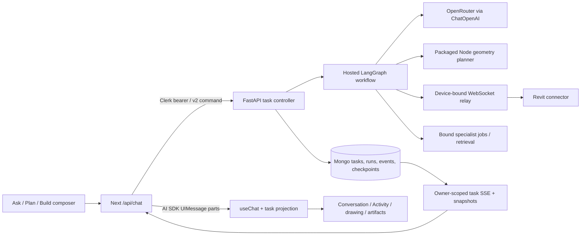

# DATUMM — current agent/UI architecture audit

Research date: 16 November 2026. Status: observation and planning only; no migration approved or implemented. Read with [research](AGUI_FEATURE_RESEARCH.md), [gaps](AGUI_GAP_ANALYSIS.md), [target](AGUI_TARGET_ARCHITECTURE.md), [roadmap](AGUI_MIGRATION_PLAN.md) and [paused-work handoff](../ux/HANDOFF.md).

## Scope and evidence

Three independent Terra workers inspected frontend, backend and drawing/approval boundaries; the coordinating agent inspected transport, dependencies, tokens, official documentation and public browser references. Findings distinguish source inspection, prior tests, current browser observation and proposals. No new prompts, native writes, fault injection, packages or deployments were run in this audit.

Web checkout: `codex/ui-ux-foundation-2026-11-12`, HEAD `e8b9b36e887dbc482592ae99b8597091b78201d6` plus substantial preexisting uncommitted implementation. HEAD alone does not identify the running UI. Previous current-source snapshot covers 334 files: `artifacts/ux/recheck-2026-11-16/current-frontend-source.json`, SHA-256 `303daf808eaf57bb4666fc0c5bbb0467ee68a15c3f908539eade55589a124d8a`.

Backend source inspected at `artifacts/ux/checklist-completion/candidate/` (abbreviated **B/** below), commit `4eb6135862fcd6083d798f5eaff4f9c1e4a79f00`. Recorded deployed base is `188ebc0bc0599ff84f3760aaef24711e522972ae`; new count clarification is local only. Backend line numbers refer to the local candidate; shared architecture is unchanged by its seven-file count patch. Deployment identity was not revalidated against AWS during this audit.

## Current architecture



The hosted application is not simply a browser around the desktop OpenCode runtime. It runs a custom FastAPI/LangGraph workflow, with a Node geometry tool and device relay. The separate desktop runtime has its own OpenCode/MCP broker. AG-UI must adapt the hosted domain contracts first rather than assuming an OpenCode adapter will cover them.

## Frontend inventory and hierarchy

Versions from [package.json](../../package.json): Next 16.4.3, React/React DOM 19.3.0, AI SDK 7.0.114, `@ai-sdk/react` 4.0.117, Streamdown 2.6.0, Three 0.186.1, Radix 1.6.7, Lucide 1.48.0, Tailwind 4.3.3, TypeScript 5.9.3, Clerk 7.9.7. Local Node is 24.18.0. Installed transitive Zod is 4.6.7; it is not a direct declared dependency. No AG-UI, CopilotKit or A2UI dependency is declared.

| Responsibility | Actual source and inspected lines | Observation |
| --- | --- | --- |
| Shell and pane ownership | `src/components/workspace.tsx:66–100,224–227,983–1013` | Stable navigation/chat/work area, scoped output provider, focus restoration and identity-keyed drawing |
| State orchestration | `src/components/workspace/use-workspace-state.ts:98–199,542–577` | Large React hook/state/ref owner; AI SDK useChat/DefaultChatTransport; no Redux/Zustand owner in current app |
| Chat transport | `src/app/api/chat/route.ts:7–41` | Bounded latest-prompt command, idempotent admission; v2 SSE translated to transient data-run/data-progress and text chunks |
| Authentication proxy | `src/lib/backend.ts:4–12`; `src/app/api/service/[...path]/route.ts` | Clerk token server-side; HTTPS origin/path restriction, no-store and timeouts; commands remain server-authorized |
| Projection/replay | `src/lib/task-projection.ts:1–21` | Cursor deduplication, gap holding, task/version admission and full-snapshot reconciliation |
| Conversation history | `use-workspace-state.ts:441,590–608,739–751,821–839`; `workspace/conversation.tsx:510–606` | Saved tasks/turns are authoritative; transient message ownership is task-scoped; historical answers retain origin |
| Local drafts | `src/lib/prompt-drafts.mjs:1–27` | Bounded account/task storage: seven days, twenty drafts; heuristic secret filtering is not comprehensive protection |
| Polling | `src/lib/settled-poll.mjs:1–28` | 1.5s active / 20s other active-or-paused; settled tasks stop; visibility/backoff and task-list cadence separate |
| Public activity | `src/components/workspace/turn-process.tsx:175–234`; `src/components/agent-activity.tsx:20,49–68` | Recorded actions, expandable tools/participants; explicit unconfirmed states; live public update trimmed to 160 characters |
| Checklist and usage | `workspace/activity-panel.tsx:74–99,120–165`; `src/lib/agent-todos.mjs:1–18` | Actual task plan/native todos; unknown turn provenance labelled; context estimate separate from ledger totals |
| Tool diagnostics | `agent-activity.tsx:142–152,173–179`; `vendor/affectui/tool-call-card-clean.tsx:215–226,363–369,484` | Structured arguments/results can be inspected when evidence supplies them; missing evidence is labelled, not invented |
| Markdown | `src/components/ai-elements/message.tsx:311–325,338–374` | Memoized Streamdown, HTML skipped, Mermaid plugin, table fullscreen; not a general typed component registry |
| Questions | `src/components/agent-questions.tsx:9–47`; `opencode-questions.tsx:8–27` | Hosted versioned questions separate from native questions; grouped answers, draft and Later/Show |
| Approvals | `src/components/review/proposal-approval.tsx:8–34`; `workspace/conversation.tsx:433–478` | Exact proposal/hash/document/revision/expiry binding; web acceptance separate from native Build |
| Stop/pause | `workspace/conversation.tsx:1290–1322`; `workspace/composer.tsx:626–632` | Requested cancellation distinguished from confirmed terminal outcome |
| Outputs | `workspace/output-workspace.tsx:15–42,82`; `assets-panel.tsx`; `exports-panel.tsx`; `review-report.tsx:127–129,199,280` | Task/source-scoped registry, saved revision preview and revision-specific download; not arbitrary model UI |
| Drawing | `src/components/plan-canvas.tsx:15–17,183–218`; `plan-three.tsx:32–43,132–138,186–187` | Common loaded graph; dark 2D/white sheets, lazy schematic 3D, WebGL fallback |

```text
Workspace
  Navigation / account / projects
  Conversation
    Saved turns + task-bound transient reply
    TurnProcess → recorded actions/tools/participants
    Streamdown answer → scoped output previews
    Question / web acceptance / exact native approval
    Composer (Ask / Plan / Build; placeholder-only suggestions)
  Work area
    Design → PlanCanvas → 2D / schematic Three scene
    Activity → checklist, context/usage, events, diagnostics
    Assets → source-bound preview
    Exports → saved revisions + downloads + latest evidence
```

## Harness and persistence inventory

| Responsibility | Backend evidence | What actually exists |
| --- | --- | --- |
| Runtime | `B/apps/domain-api/agent_workflow.py:3690+`; `main.py:59–64`; `pyproject.toml` | LangGraph 1.2.12, Python 3.12, FastAPI 0.141.1, MongoDBSaver checkpoints/writes |
| Providers / execution | `agent_workflow.py:1748–1756`; `budget.py:468–478` | OpenRouter through ChatOpenAI; bound tool choice, parallel_tool_calls false; awaited ainvoke, not provider text-delta streaming |
| Skills | `agent_workflow.py:35,1488` | Configured skills_prompt inserted into stage prompt; repo-installed development skills are not automatically product agent tools |
| Tool dispatcher | `agent_workflow.py:2275,2591–2595,2645+,2748–2758` | Domain tool branches, result evidence, finish_answer admission, checkpointed progress |
| Geometry engine | `variable_engine.py:20–96`; `apps/planner/revit-mcp/src/program-search.ts:114–151` | Fixed packaged Node CLI, bounds/time/output/provenance validation; bounded orthogonal single-level search |
| Native bridge | `main.py:420`; `relay.py:28–79` | Serialized request IDs and device fencing over WebSocket; uncertain results need reconciliation; not the MCP wire itself |
| Desktop contrast | `B/apps/desktop/src/main/README.md:3,20,63–66` | Separate OpenCode/MCP runtime. Web parity is not established |
| Specialists | `specialist_jobs.py:318–323,342–466` | Optional bounded jobs/batches/parallel work, task/run/version binding and verified digests; completion summaries, not full live child traces |
| Retrieval | `knowledge.py:1–3,26,126–140,206–240`; `agent_workflow.py:1056–1058,2591–2595` | Admin-ingested HTML chunks, embeddings and in-process cosine search; web/RAG excerpts treated as untrusted cited evidence; quality not fully evaluated |
| Memory | `agent_memory.py:53–83,100–195`; `agent_compaction.py:153–240` | Revision-aware evidence memory and compaction; separate project Brief & decisions with explicit Use in chat |
| Event durability | `storage.py:177–224`; `task_events.py:26–77` | Run sequence/outbox; 200 inline events; separate durable task projection, retryable publication, allowlisted metadata |
| Usage | `budget.py:256–309,380–465`; `task_controller.py:205–218` | Per-call ledger and projected coverage/context estimates; not an AG-UI token event stream |
| Questions | `agent_questions.py:48–99`; `main.py:632–700` | Versioned answer receipt and checkpoint continuation |
| Lifecycle control | `main.py:1104–1165`; `task_contracts.py:27–145` | Question/approval/build/task/job states; pause, resume, cancel request and reconciliation remain distinct |

## Event-by-event trace

Common delivery **D** for imported run events: producer → run storage/outbox → task event projection (`storage.py:177–224`, `task_events.py:26–77`) → owner-scoped GET SSE (`task_api.py:182–199`, 300ms polling, `after` cursor, final snapshot) → Next chat parser → transient AI SDK part → `reduceProjection`/saved task → renderer. Direct task producers enter at the task-event store instead: command admission (`task_controller.py:504`), chat-build answer (`:721`) and scheduler results (`task_scheduler.py:216`). Snapshots carry richer state than individual public events. **D is near-real-time for emitted events, not token streaming.** Persisted events/checkpoints survive refresh; transient frontend-only parts are reconstructed from authoritative state. This is not an exactly-once guarantee across every fault.

| Requested signal | Origin / actual representation | Transport, storage, parser | Renderer | Real-time / refresh / failure limit |
| --- | --- | --- | --- | --- |
| Agent started | Controller running state; workflow public planning/activity | D + task snapshot | TurnProcess, Activity | State visible; no native RUN_STARTED contract |
| Reasoning/activity | Workflow safe operational summary, not private reasoning | D, public detail allowlist | TurnProcess | Emitted steps update; hidden chain-of-thought must stay excluded |
| Tool started | Agent action/relay activity with available call identity | D; richer tool evidence separately | Process and tool card | Available when emitted; model argument generation itself not streamed |
| Tool running | Current event/state inference, no universal heartbeat | D/snapshot | Process status | Long silent tools lack granular progress; do not invent percentage |
| Tool completed | Step complete/outcome plus evidence | D + evidence store | Activity/diagnostics | Structured result only if captured; refresh from saved evidence |
| Tool failed | Failure stages/codes, tool evidence | D + task failure | Recovery message/tool card | Retry and unknown side effects need domain reconciliation, not automatic replay |
| Sub-agent spawned | Optional specialist job exists; no complete public start event contract | Job store; limited public projection | Recorded participants/reviews | Full spawn-to-start timeline missing |
| Sub-agent completed | specialist_complete after bound result collection | D + specialist jobs | Activity/specialist reviews | Completion persists; child token/tool attribution incomplete |
| Task created | v2 submit admission | Command response + durable task | Sidebar/task selection | Stored; idempotent admission protects duplicate requests |
| Task updated | Versioned commands, checkpoint/projection | D + snapshot | Workspace/progress | Stale/foreign snapshots rejected; cursor gaps held |
| Task completed | Terminal task projection | Snapshot + end of SSE | Status/process | Task completion differs from web review/native completion |
| Final answer | finish_answer → response_ready / public answer projection; direct task answer paths also exist | D or direct task event; AI SDK text-delta wraps public detail | Streamdown | Public detail capped at 2,000 characters while finish_answer allows 3,000; full saved task result is authority, not transient chunk |
| User approval required | Versioned question/native proposal and permissions | Persisted checkpoint + snapshot + command receipt | Questions/approval | Refresh supported; exact identity/expiry required; no text approval |
| Agent execution completed | Model/turn settled, run/task status | D + snapshot | Activity/process | Must distinguish waiting, cancelled, failed, partial and successful |
| Cancellation | Explicit cancel request, settlement/reconciliation | Command + D | Composer/Activity | HTTP disconnection is not proof of stopped native work |

## AffectUI adoption: actual versus planned

[Vendor provenance](../../src/components/vendor/affectui/PROVENANCE.md) records 22 copied MIT component files pinned to upstream `7d0f0984b856d56c362c7bc5ed67b023e776aa2f`, with compatibility patches. Current static import inspection finds **21 distinct referenced vendor modules**, including style-only adapters; segmented-control-clean currently has no external reference. The historical inventory's “22 imported” wording is not current runtime evidence. NumberInput and ProgressTracker were reference-only. Pro screens were independently reconstructed from public previews, not copied from gated source.

Tokens: `src/lib/themes/affectui.json`, `src/lib/appearance.ts:63+`, Inter dependency and application CSS. Dark page/panel/tray `#0e0e10` / `#141416` / `#1d1d20`; primary `#ededed`, accent `#4fb0fe`; light roles also present. Preserve current 224px navigation choice even though upstream token metadata retains 272px. No second theme is needed. Existing Radix focus behavior and Lucide/custom icons should remain behind the current adapters. Inspect actual icon shape/size per reference rather than installing an icon package merely for parity.

Browser observation this audit: [Agent Thread](https://www.affectui.com/screens/agent-thread/full) collapses completed tools into a count/duration row, expands named tool statuses, shows compact step counts, puts a waiting question above the composer, and Later changes it to a small waiting tray with Show. These are reference demo states, not evidence of DATUMM orchestration. Dojo's [agent-state example](https://dojo.ag-ui.com/?integration=built-in-agent&demo=gen-ui-agent) loads a chat and its Code view shows one shared step card subscribed to agent state. No remote model request was submitted. Its generic isRunning→complete example must not be copied as DATUMM completion truth.

Actual localhost inspection of saved task `964068a2-13f6-5659-a552-3f9323c2134e` showed a 14,000 × 9,000mm v3 drawing; Activity showed no checklist recorded, 15 loaded events, report specialist completion, 0.4% estimated latest input and separately 34,540 input / 8,766 output ledger tokens. This confirms those UI surfaces exist; it does not qualify a new live run, AG-UI, connected Revit or streaming failure recovery.

## Strengths to preserve

Owner/task/turn/revision fencing; command idempotency; exact native approval; separate web plan acceptance; immutable plans/reports; source-bound downloads; actual usage with uncertainty labels; question drafts and Later/Show; existing safe Markdown and polished control primitives; responsive drawing focus and task recovery. The problem is not an absence of all agent UI. It is fragmented semantics, incomplete producer observability and unmeasured performance under richer streams.

## Test truth and unresolved work

Earlier same-day recheck passed 535 frontend tests, TypeScript and 24 acceptance hashes; prior qualified pass included production build, 13 runtime checks and 320–1440px browser journeys. Those retain their recorded source scope and were not rerun by this research task. Full reconnect fault testing, native write/read-back, broad accessibility/hardware testing, performance baselines, restore testing and full release remain unqualified.

Local count clarification commit passed recorded local suites (API 132 + nine subtests and focused checks). Six Python committed blobs match tested bytes; planning.md differs only CRLF→LF. Exact whole-source/container qualification is still open, graph extraction freshness fails, AWS renewal was pending and nothing was deployed. See handoff for resumption without confusing this candidate with live base188.

Unknowns: full production deployment configuration/timeouts; durable event retention under long workloads; exact model streaming/fallback support; rate/volume expectations; native transaction/read-back capabilities by tool; generator replacement requirements. These are Phase 0 measurements/decisions, not reasons to replace the harness now.

Final audit integrity check: all 334 frontend files match the earlier same-day snapshot; isolated backend remains clean at 4eb6135. Independent frontend/backend/approval reviewers checked the planning documents; their corrections on direct task events, full-answer authority, vendor usage and safe recovery are incorporated. Local document links and code-fence balance passed. This is document/source review, not a new application or AG-UI runtime test.
